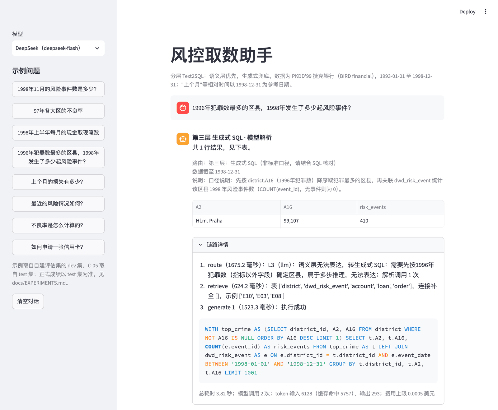
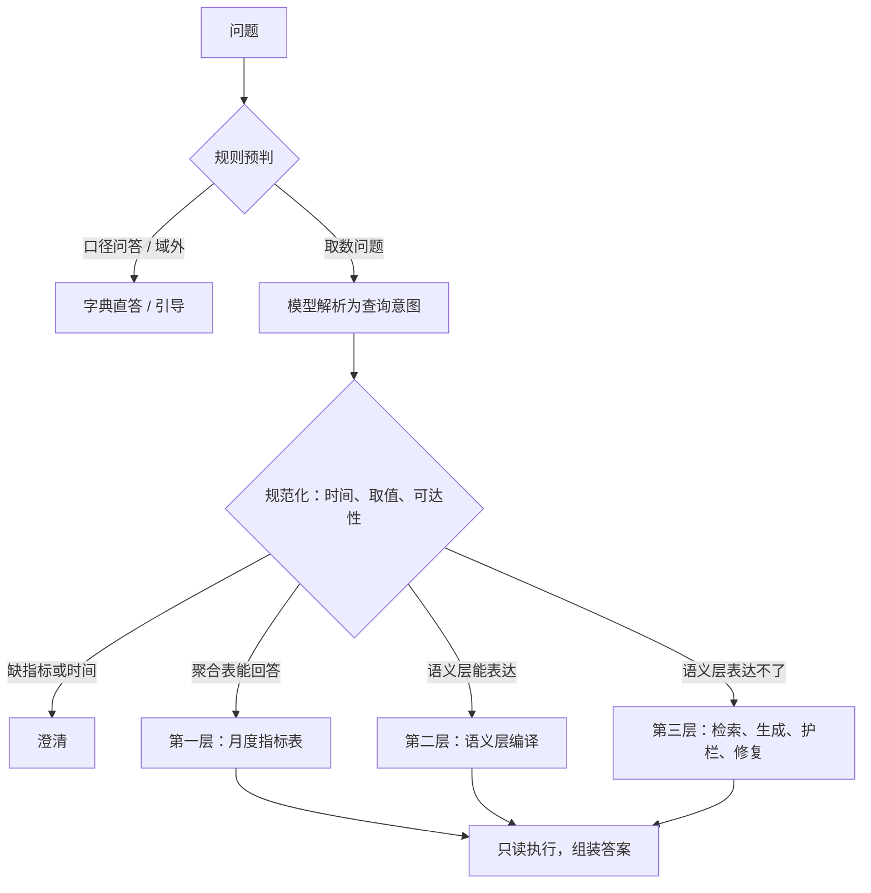

# 分层 Text2SQL：银行风控取数助手

中文 | [English](README_EN.md)

这是一个面向银行风控取数场景的 Text2SQL 系统。出发点很简单：业务方问得最多的，是风险事件数、不良率、风险涉及金额这类有固定口径的指标，这类问题不应该每次都让模型现写 SQL。系统把语义层能表达的问题解析成结构化的查询意图，由代码编译成 SQL；语义层表达不了的长尾问题，才交给模型生成 SQL，并经过检索、语法树护栏、干跑和按错误类型的修复。数据来自 PKDD'99 捷克银行的真实脱敏数据（BIRD 基准中的 financial 库），在此之上构建了风险事件表和月度指标表。



## 结果

| 设置 | 结果 |
|---|---|
| 自建测试集 60 题（DeepSeek，3 轮） | 执行准确率 93.8%；语义层路径 100%，生成路径 83.3% |
| 同一批题全部让模型直接写 SQL | 85.4% 至 88.2%；忽略输出格式差异后为 95.8% 至 97.2% |
| BIRD financial 106 题（生成路径，严格口径） | DeepSeek 22.0%，Claude Sonnet 5.5 27.4%（单轮） |
| 成本与延迟 | 每题约 1.35 次模型调用，延迟中位数 1.59 秒，费用上限约 0.0003 美元 |

自建评估集在开发前冻结，开发期间没有查看测试集；表中是测试集首次运行的成绩，看过测试集之后做的修复（98.6%）单独报告，不计入上表。忽略输出格式差异后，直接生成的数值正确率并不比分层低，差别在可靠性：分层路径 48 道取数题三轮结果全部一致，直接生成为 44 至 46 道；6 道应当澄清的问题，分层路径只有 5.6% 直接作答，直接生成则全部自行选定口径。BIRD 一行只评测生成路径，使用 2025-11 清洗版的 financial 单库和严格的结果集比较，不能与 BIRD 榜单直接比较。完整设置、逐题误差分析，以及第三层消融、表结构检索、模型对比三组实验，见 [docs/EXPERIMENTS.md](docs/EXPERIMENTS.md)。

## 工作方式



一个问题先经过规则：口径问答、与数据无关的问题、多义词和"最近"这类模糊时间由规则直接处理，只有一个指标加时间和地区的简单问题走快速通道，都不调用模型。其余问题由模型做一次结构化解析，输出指标、维度、筛选条件和时间原文；时间换算、取值编码、维度可达性和数据范围由代码完成。语义层能表达的问题编译成 SQL，如果月度指标表能回答就直接查表。

语义层表达不了的问题进入生成路径：按问题检索相关的表并补上关联所需的中间表，注入指标口径、取值编码和相似示例，由模型生成 SQL。SQL 先过语法树白名单，再做 EXPLAIN 干跑，然后只读执行；出错时按错误类型决定是否带着报错重写，最多三次。答案附带 SQL、口径、统计区间和数据截止日期，以及代码替用户做的全部默认假设。

## 设计取舍

### 常见问题不让模型写 SQL

语义层能表达的问题，模型只填一份带类型的查询意图：指标、维度、筛选条件和时间原文。必须精确的部分，包括日期换算、取值编码、关联路径和指标口径，都在代码和 `semantic/*.yaml` 里完成。因此第一、二层的准确率与用哪个模型无关：给定标注好的意图，51 道题全部编译出与金标一致的结果；换成 Claude 之后，这两层的成绩也没有变化。

### 规则只做有把握的判断

规则可以不判，但不能判错，判不准的问题交给模型。测试集上四分之一的问题在规则这一步就有了结果，不需要调用模型。判断"与数据无关"时，只看是否出现业务词会把"上个月多少？"这类问题误判掉，在规则探测集上精确率只有 60%；加上"多少""趋势"等取数词作为第二个条件后，提高到 89%。

### 聚合表必须考虑可加性

第一层是按月、按地区预先聚合的指标表，由第二层的同一个编译器生成，两条路径的口径因此一致。能不能用聚合表回答，由代码根据维度、粒度、时间对齐和可加性判断，模型不读任何数字。可加性最容易出错：1997 年第四季度的风险账户数，三个月的月值相加是 438，按账户去重只有 333，所以去重计数类指标跨月时一律回到明细表计算。

### 修复只能修报错

生成的 SQL 在执行前要通过语法树白名单（只允许单条查询，只能访问字典中的表）；在 9 种攻击写法上，白名单全部拦下，关键词黑名单只拦住 6 种。执行出错时，按错误类型决定是否重写，表不存在或写操作这类错误不重试。但修复的作用有限：BIRD 上约 8% 的题次需要修复，25 次只修好 2 次，因为大多数失败的 SQL 能正常执行，只是答案不对。对比 Claude 时还发现，它在信息不足时会写一条结果必然为空的占位查询；空结果不触发修复，原本依靠报错触发的补表机制因此失效。

更多设计细节见 [docs/DESIGN.md](docs/DESIGN.md)。

## 局限

主要的失败来源是路由：测试集上每轮都答错的 3 道题，两道是把可回答的问题判为与数据无关，一道是把语义层没有覆盖的表硬套进已有指标。自建评估集只有 101 题，由一人编写，测试集也已经被多次查看，后续改进需要新的保留评估集。BIRD 困难题大多要求输出很多列，在严格比较下很难得分。占位查询的识别还没有实现。

## 快速开始

需要 Python 3.12 和 [uv](https://docs.astral.sh/uv/)。

```bash
uv sync --extra app                           # 安装依赖，包括 Streamlit
uv run python scripts/download_data.py        # 下载 BIRD financial 库与清洗版题目（压缩包约 346 MB）
uv run python scripts/build_warehouse.py      # 构建风险事件表与月度指标表
cp .env.example .env                          # 填入 DEEPSEEK_API_KEY；模型对比另需 ANTHROPIC_API_KEY

uv run t2s ask "1998年11月的风险事件数是多少？"
uv run t2s chat                               # 交互模式，可以直接回答澄清问题
uv run --extra app streamlit run app/streamlit_app.py --server.address localhost
uv run --group dev pytest -q
uv run python scripts/run_eval.py --mode oracle --split all   # 给定标注意图，只测编译与执行，不调用模型
```

没有配置 API Key 时，规则能处理的问题仍然可以回答；`--provider none` 可以显式关闭模型。评估入口是 `scripts/run_eval.py`，例如 `--split test --repeats 3 --name x1_test`；`scripts/summarize_runs.py` 把运行结果写进实验报告。

## 项目结构

```text
semantic/            语义层：表与字段字典、关联关系与维度取值、18 个指标的口径
src/text2sql/
  semantic/          语义模型、查询意图、时间解析、取值链接、编译器、聚合表
  pipeline/          规则、解析、规范化、路由、第三层、答案组装、工作流
  knowledge/         表级检索（BM25、向量、RRF 融合、关联补全）
  db/                只读执行器与 SQL 护栏
  llm/               DeepSeek 与 Claude 客户端
  eval/              评估集加载、执行准确率比较、指标与费用
app/                 Streamlit 界面
eval/                自建评估集与规则探测集
scripts/             数据下载、数仓构建、评估与报告
```

设计说明见 [docs/DESIGN.md](docs/DESIGN.md)，实验报告见 [docs/EXPERIMENTS.md](docs/EXPERIMENTS.md)，数据探查见 [docs/DATA_PROFILE.md](docs/DATA_PROFILE.md)，评估集的构成与判定规则见 [eval/README.md](eval/README.md)。

## 数据与许可

代码与文档使用 MIT 许可证，见 [LICENSE](LICENSE)。数据来自 [BIRD](https://bird-bench.github.io/) 的 financial 库（源自 PKDD'99 Discovery Challenge）和 2025-11-06 清洗版题目，许可为 CC BY-SA 4.0，由脚本下载，不随仓库分发。向量模型为 [BAAI/bge-small-zh-v1.5](https://huggingface.co/BAAI/bge-small-zh-v1.5)（MIT），首次使用时由 fastembed 下载。
