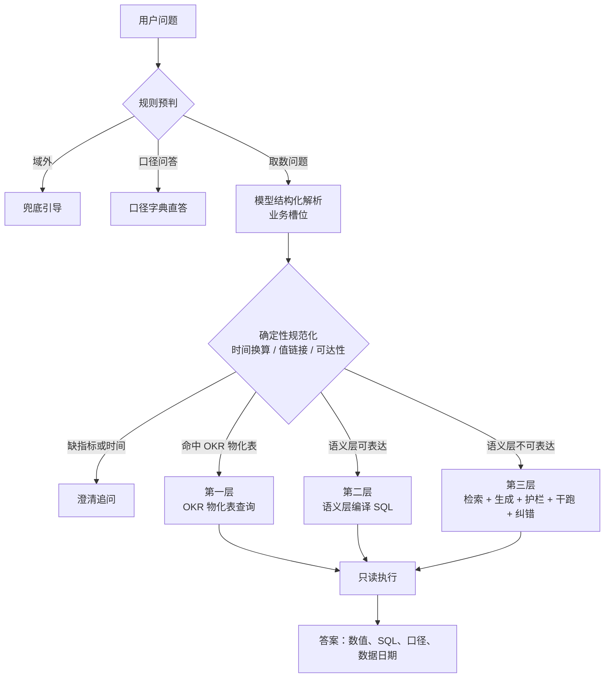

# 分层 Text2SQL：银行风控取数助手

中文 | [English](README_EN.md)

面向银行风控取数场景的 Text2SQL 系统：语义层优先，生成式兜底。常见问题由模型解析为业务槽位，再由语义层确定性地编译成 SQL；语义层表达不了的问题才交给模型生成 SQL，并经过检索、护栏、干跑与纠错。数据为 PKDD'99 捷克银行真实脱敏数据（BIRD financial），在其上构建了风险事件表与月度 OKR 指标表。

**English summary.** A tiered Text2SQL agent for bank risk analytics. Questions the semantic layer can express are parsed into slots and compiled into SQL deterministically; only the rest go to LLM SQL generation with retrieval, an AST guard, EXPLAIN dry runs and typed repair. On a frozen 60-question test set it reaches 93.8% execution accuracy over 3 runs (layers 1 and 2: 100%). Five experiments compare it with direct generation, ablate layer 3 on BIRD, test schema retrieval and compare DeepSeek with Claude. See [README_EN.md](README_EN.md).

## 1. 架构



规则能确定的问题（单指标、时间与地区明确）走快速通道，不调用模型。第一层与第二层的 SQL 由同一套语义层定义生成，模型不写 SQL、不读数字。

## 2. 主要结果

自建评估集 101 题（dev 41 / test 60）在开发前冻结；BIRD financial 106 题用作第三层外部基准。默认模型为 DeepSeek deepseek-flash，每组实验 3 轮。完整表格与误差分析见 [docs/EXPERIMENTS.md](docs/EXPERIMENTS.md)。

| 实验 | 设置 | 结果 |
|---|---|---|
| X1 端到端 | 自建 test 60 题 | 执行准确率 93.8%（3 轮一致），第一、二层 100%，第三层 83.3%；路由准确率 94.4%；延迟中位数 1.59 秒；每题费用上限约 0.0003 美元。失败全部来自路由判断；看过 test 后的修复版本为 98.6%，单独列出，不替换正式成绩 |
| X2 分层与直接生成 | test 48 道取数题 | 执行准确率：分层 93.8%，同一第三层处理全部题 85.4%，朴素基线 88.2%；格式差异视为正确时 93.8% / 95.8% / 97.2%。结果三轮一致 48/48、46/48、44/48；6 道应澄清的题直接作答的比例 5.6% / 100% / 100% |
| X3 第三层消融 | BIRD 106 题，严格口径 | 完整第三层 22.0%（简单 50.0%、中等 37.3%、困难 3.5%）；去掉示例 17.9%，去掉纠错 21.1%。困难题 57 道中 50 道金标超过 5 列 |
| X4 表结构 | 同 X3 | 全量 22.0%，BM25 21.7%，向量 21.1%，混合 22.0%；所需表全部召回分别为 106、78、67、73 题 |
| X5 模型对比 | Claude Sonnet 5.5，单轮 | 自建 test 97.9%（提升全部来自路由），BIRD 27.4%（全量表结构 31.1%）；费用约 18 至 20 倍，延迟约 2 倍 |

结论：

1. 在 10 张表的规模下，直接生成的数值正确率与分层链路相当；语义层的价值在于同一问题每次同一结果、口径与相对时间由代码保证、多义问题会追问。
2. 第一、二层的正确率与模型无关，换用更强的模型，收益集中在路由与第三层。
3. 纠错修得了报错，修不了口径；召回差距没有转化为准确率差距，主要失败在列的选择与数值语义。
4. 更强的模型在信息不足时会写出恒为空的占位查询，绕过了以报错触发的补表机制，这一发现列入后续改进。

BIRD 结果使用 2025-11 清洗版 financial 单库与严格口径，第三层默认只取检索出的表，不能与 BIRD 榜单直接比较。

## 3. 演示

Streamlit 界面：对话式提问，指标与时间澄清可以直接回答，每条回答可展开链路详情（逐步耗时、SQL、IR、调用次数与费用上限）。下图为第三层问题的回答：


命令行（规则快速通道，不调用模型）：

```text
$ uv run t2s --provider none --trace ask "1997年第四季度南摩拉维亚的风险账户数是多少？"
╭──────────────────────── 第二层 语义层编译 · 快速通道 ────────────────────────╮
│ 1997-10-01 至 1997-12-31：风险账户数 56户。                                  │
│                                                                              │
│ 路由：第二层：语义层编译 SQL                                                 │
│ 时间范围：1997-10-01 至 1997-12-31；数据截至 1998-12-31                      │
│ 口径：风险账户数：统计期内至少命中一次监测规则的去重账户数。去重计数不可加。 │
│ 筛选：地区 = 南摩拉维亚                                                      │
╰──────────────────────────────────────────────────────────────────────────────╯
┏━━━━━━━━━━━━┓
┃ 风险账户数 ┃
┡━━━━━━━━━━━━┩
│ 56         │
└────────────┘
╭───────────────────────────────── SQL ─────────────────────────────────╮
│ SELECT COUNT(DISTINCT dwd_risk_event.account_id) AS risk_account_cnt  │
│ FROM dwd_risk_event                                                   │
│ JOIN district ON dwd_risk_event.district_id = district.district_id    │
│ WHERE district.A3 IN ('south Moravia')                                │
│   AND dwd_risk_event.event_date BETWEEN '1997-10-01' AND '1997-12-31' │
╰───────────────────────────────────────────────────────────────────────╯
  route           0.3 ms  L2（fast_path）：单指标简单问题，规则完成解析
  compile         2.7 ms  1 条 SQL（L2）
  execute         1.0 ms  成功
  总耗时 0.00s；LLM 调用 0 次；token 0+0
```

去重计数不能把三个月的月值相加，所以这题不走第一层的月度物化表，而是回到风险事件表计算。

## 4. 快速开始

需要 Python 3.12 与 [uv](https://docs.astral.sh/uv/)。

```bash
uv sync --extra app                          # 安装依赖（含 Streamlit）
uv run python scripts/download_data.py       # 下载 BIRD financial 数据库与清洗版题目（压缩包约 346 MB，只保留所需文件）
uv run python scripts/build_warehouse.py     # 构建风险事件表与月度 OKR 物化表
cp .env.example .env                         # 填入 DEEPSEEK_API_KEY；对比实验另需 ANTHROPIC_API_KEY
```

```bash
uv run t2s ask "1998年11月的风险事件数是多少？"     # 单次提问
uv run t2s chat                                      # 交互式，可直接回答澄清
uv run --extra app streamlit run app/streamlit_app.py --server.address localhost   # 演示界面
uv run --group dev pytest -q                         # 测试
uv run python scripts/run_eval.py --mode oracle --split all   # 解耦评估：给定金标 IR，无需模型
```

未配置 API Key 时，规则能判定的问题（口径问答、快速通道等）仍可回答，加 `--provider none` 显式关闭模型。真实模型评估的入口为 `scripts/run_eval.py`（例如 `uv run python scripts/run_eval.py --split test --repeats 3 --name x1_test`），汇总与写入报告用 `scripts/summarize_runs.py`；运行前请参考 [docs/EXPERIMENTS.md](docs/EXPERIMENTS.md) 中各实验的费用。

## 5. 设计要点

1. **模型只输出业务槽位，SQL 由语义层编译。** 指标口径、维度取值、关联路径写在 `semantic/*.yaml`，编译器按查询类型套用参数化模版，用户输入只以参数绑定。两个模型下第一、二层都是 100%；给定金标 IR 的解耦评估 51 题全部正确。
2. **规则在前，模型在后。** 规则只做有把握的判定（口径问答、域外、多义词、模糊时间、快速通道），可以不判，不能判错；X1 中 25% 的问题不调用模型。相对时间由规则基于参考日期换算，直接生成时模型用真实的当前日期计算"上个月"，结果为空。
3. **第一层是语义层的物化缓存。** OKR 表由第二层的同一个编译器生成，两层口径一致由构造保证。去重计数不可跨月相加：1997 年第四季度风险账户数，月值相加为 438，真实去重为 333，这类问题回到基表计算。
4. **值链接与澄清。** 业务说法翻译为库内编码，不翻译时"1998年南摩拉维亚取现的交易笔数"返回 0，正确答案为 22,550。指标多义或时间不明确时追问，命令行与界面都可以直接回答，最多 3 轮。
5. **第三层的安全与纠错。** sqlglot 语法树白名单护栏拦截了 9 种攻击写法（关键词黑名单只拦住 6 种），187 条金标 SQL 无一误拦；数据库只读连接；EXPLAIN 干跑；按错误类型修复，最多 3 次，不可恢复的错误不重试。
6. **评估纪律。** 评估集先于开发冻结；test 的首次结果为正式成绩，看过 test 后的修改单独列出；每组实验 3 轮；报告中的表格由脚本从运行结果生成。

## 6. 目录结构

```text
semantic/        语义层：catalog.yaml（表与字段）、dimensions.yaml（关系与维度取值）、metrics.yaml（18 个指标）
src/text2sql/
  semantic/      语义模型、IR、时间解析、值链接、编译器、OKR 物化
  pipeline/      规则、解析、规范化、路由、第三层生成与纠错、答案组装、工作流
  knowledge/     表级检索（BM25、向量、RRF 融合、连接补全）
  db/            只读执行器、EXPLAIN 干跑、SQL 护栏
  llm/           DeepSeek 与 Claude 客户端（统一接口）
  eval/          评估集加载、执行准确率比较、指标、费用
  cli.py         命令行 t2s ask / t2s chat
app/             Streamlit 演示界面
knowledge/       第三层 SQL 示例库
eval/            自建评估集、规则探测集、评估说明
scripts/         数据下载、数仓构建、评估运行与报告生成
docs/            规划、数据探查、实验报告
tests/           单元与集成测试（不调用真实模型）
```

## 7. 文档

| 文档 | 内容 |
|---|---|
| [docs/PLAN.md](docs/PLAN.md) | 项目规划、架构与关键设计决策 |
| [docs/ENGINEERING.md](docs/ENGINEERING.md) | 工程文档：模块、数据结构、处理流程、配置、评估与扩展方法 |
| [docs/EXPERIMENTS.md](docs/EXPERIMENTS.md) | 实验 X1 至 X5 的设置、结果与误差分析 |
| [docs/DATA_PROFILE.md](docs/DATA_PROFILE.md) | 数据探查与风险规则阈值的依据 |
| [eval/README.md](eval/README.md) | 评估集构成、基准约定与判定规则 |

## 8. 数据与许可

1. 代码与文档：MIT 许可证，见 [LICENSE](LICENSE)。
2. 数据：[BIRD](https://bird-bench.github.io/) financial 数据库（源自 PKDD'99 Discovery Challenge 捷克银行数据）与 BIRD dev 2025-11-06 清洗版题目，CC BY-SA 4.0；由脚本下载，不随仓库分发。风险事件表与 OKR 物化表由脚本在本地生成。
3. 向量模型：[BAAI/bge-small-zh-v1.5](https://huggingface.co/BAAI/bge-small-zh-v1.5)（MIT），经 fastembed 在首次使用时下载。
