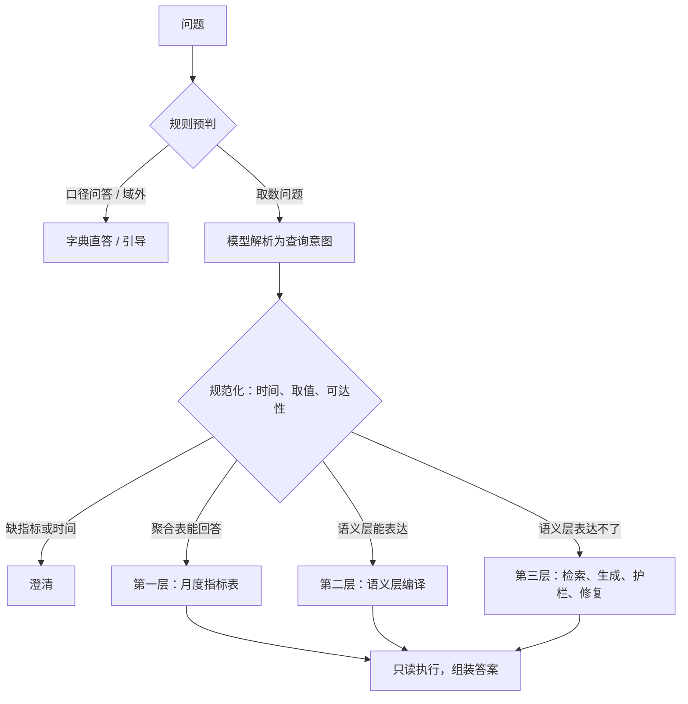

# 分层 Text2SQL：银行风控取数助手

中文 | [English](README_EN.md)

面向银行风控取数的 Text2SQL 系统。风险事件数、不良率这类固定口径的指标问题，由模型解析为结构化查询意图，再由代码编译成 SQL；语义层表达不了的长尾问题由模型生成 SQL，经检索、语法树护栏、EXPLAIN 干跑和按错误类型修复后执行。数据为 PKDD'99 捷克银行脱敏数据（BIRD 基准的 financial 库），另构建了风险事件表和月度指标表。


## 结果

| 设置 | 结果 |
|---|---|
| 自建测试集 60 题（DeepSeek，3 轮） | 执行准确率 93.8%；语义层路径 100%，生成路径 83.3% |
| 同一批题全部让模型直接写 SQL | 85.4% 至 88.2%；忽略输出格式差异后为 95.8% 至 97.2% |
| BIRD financial 106 题（生成路径，严格口径） | DeepSeek 22.0%，Claude Sonnet 5.5 27.4%（单轮） |
| 同上，混入 67 张干扰表（共 75 张表） | 原检索 14.2%；换用多语言向量模型并修正检索后 21.7%（2 轮）；选表与裁剪将上下文压缩到约四分之一，准确率未提高 |
| 成本与延迟 | 每题约 1.35 次模型调用，延迟中位数 1.59 秒，费用上限约 0.0003 美元 |

评估集在开发前冻结，表中为测试集首次运行的成绩；看过测试集后的修复（98.6%）单独报告。忽略输出格式后，直接生成与分层的数值正确率相当，差别在可靠性：三轮结果全部一致的取数题，分层为 48/48，直接生成为 44 至 46 道；6 道应澄清的问题，分层直接作答的比例为 5.6%，直接生成为 100%。BIRD 两行只评测生成路径（2025-11 清洗版 financial 单库，严格结果集比较），不能与 BIRD 榜单直接比较。完整设置与逐题误差分析见 [docs/EXPERIMENTS.md](docs/EXPERIMENTS.md)。

## 工作方式



规则先处理口径问答、域外问题、多义词和"最近"这类模糊时间；单指标加时间与地区的简单问题走快速通道。这两类都不调用模型。其余问题由模型做一次结构化解析，输出指标、维度、筛选条件和时间原文，时间换算、取值编码、维度可达性与数据范围检查由代码完成。语义层能表达的问题编译为 SQL，月度指标表能回答时直接查表。

语义层表达不了的问题进入生成路径：检索相关表并补全关联中间表，注入指标口径、取值编码和相似示例后由模型生成 SQL。SQL 依次经过语法树白名单、EXPLAIN 干跑和只读执行，出错时按错误类型决定是否带报错重写，最多三次。答案附带 SQL、口径、统计区间、数据截止日期，以及代码所做的全部默认假设。

## 设计取舍

### 常见问题不让模型写 SQL

模型只输出带类型的查询意图（指标、维度、筛选条件、时间原文），日期换算、取值编码、关联路径和指标口径由代码与 `semantic/*.yaml` 完成。第一、二层的准确率因此与模型无关：给定标注意图，51 道题全部编译出与金标一致的结果；换用 Claude 后两层成绩不变。

### 规则只做有把握的判断

规则可以弃权，不能误判，不确定的问题交给模型。测试集上四分之一的问题在规则阶段完成，不调用模型。判断"与数据无关"时，只看是否缺少业务词会误判"上个月多少？"这类问题，规则探测集上精确率为 60%；增加"多少""趋势"等取数词作为第二个条件后提高到 89%。

### 聚合表必须考虑可加性

第一层是按月、按地区预聚合的指标表，与第二层由同一编译器生成，两条路径口径一致。是否改用聚合表由代码按维度、粒度、时间对齐和可加性判断，模型不读取任何数字。去重计数不能跨月相加：1997 年第四季度风险账户数，月值相加为 438，按账户去重为 333，因此这类指标跨月时回到明细表计算。

### 表多时先保证找得到表

在 BIRD financial 中混入其余 10 个库的 67 张表（共 75 张）后，原检索只让 7.5% 的题拿到全部所需的表，执行准确率从 20.8% 降到 14.2%。第三层为此增加三项可单独开启的 Schema Linking：字段级链接（字段检索、库中取值索引、语义层维度词，命中的表并入候选）、模型选表（只删不加，关联表由代码补回）、模型裁剪字段（主键、外键与取值所在字段由代码保留）。取值命中扩表将准确率提到 18.9%。原向量模型 bge-small-zh 只支持中文，换为多语言模型 bge-m3 后，所需表齐全的题从 7.5% 升到 52.8%，基线准确率为 21.7%，剩余失败主要在列的选择与语义。选表与裁剪将上下文从 6 张表、69 个字段压缩到 4 张、15 个，但未提高准确率，三项均默认关闭。

### 修复只能修报错

生成的 SQL 执行前须通过语法树白名单（单条查询，只访问字典中的表）；9 种攻击写法全部被拦截，关键词黑名单只拦住 6 种。执行出错时按错误类型决定是否重写，表不存在、写操作等错误不重试。修复收益有限：BIRD 上约 8% 的题次需要修复，25 次中只修好 2 次，多数失败的 SQL 能执行，只是答案错误。Claude 在信息不足时会写出结果必然为空的占位查询，空结果不触发修复，依赖报错的补表机制随之失效。

更多设计细节见 [docs/DESIGN.md](docs/DESIGN.md)。

## 局限

路由是主要失败来源：测试集上每轮都答错的 3 道题中，两道把可回答的问题判为与数据无关，一道把语义层未覆盖的表套进已有指标。自建评估集仅 101 题、由一人编写，测试集已被多次查看，后续改进需要新的保留评估集。BIRD 困难题大多要求输出很多列，严格比较下难以得分。大表结构实验的事后结果每组只有 1 至 2 轮，同一配置两轮可相差 4 题。占位查询识别尚未实现。

## 快速开始

需要 Python 3.12 和 [uv](https://docs.astral.sh/uv/)。

```bash
uv sync --extra app                           # 安装依赖，包括 Streamlit
uv run python scripts/download_data.py        # 下载 BIRD financial 库与清洗版题目（压缩包约 346 MB）
uv run python scripts/build_warehouse.py      # 构建风险事件表与月度指标表
cp .env.example .env                          # 填入 DEEPSEEK_API_KEY；模型对比另需 ANTHROPIC_API_KEY

uv run t2s ask "1998年11月的风险事件数是多少？"
uv run t2s chat                               # 交互模式，可以直接回答澄清问题
uv run --extra app streamlit run app/streamlit_app.py --server.address localhost
uv run --group dev pytest -q
uv run python scripts/run_eval.py --mode oracle --split all   # 给定标注意图，只测编译与执行，不调用模型
uv run python scripts/build_distractors.py    # 可选：大表结构评估用的干扰表（再下载约 346 MB 的 BIRD dev 压缩包）
```

未配置 API Key 时，规则能处理的问题仍可回答；`--provider none` 显式关闭模型。评估入口为 `scripts/run_eval.py`（如 `--split test --repeats 3 --name x1_test`），`scripts/summarize_runs.py` 将运行结果写入实验报告。

## 项目结构

```text
semantic/            语义层：表与字段字典、关联关系与维度取值、18 个指标的口径
src/text2sql/
  semantic/          语义模型、查询意图、时间解析、取值链接、编译器、聚合表
  pipeline/          规则、解析、规范化、路由、第三层、答案组装、工作流
  knowledge/         表与字段检索（BM25、向量、RRF 融合、关联补全）、库中取值索引
  db/                只读执行器与 SQL 护栏
  llm/               DeepSeek 与 Claude 客户端
  eval/              评估集加载、执行准确率比较、指标与费用
app/                 Streamlit 界面
eval/                自建评估集与规则探测集
scripts/             数据下载、数仓构建、评估与报告
```

设计说明见 [docs/DESIGN.md](docs/DESIGN.md)，实验报告见 [docs/EXPERIMENTS.md](docs/EXPERIMENTS.md)，数据探查见 [docs/DATA_PROFILE.md](docs/DATA_PROFILE.md)，评估集的构成与判定规则见 [eval/README.md](eval/README.md)。

## 数据与许可

代码与文档采用 MIT 许可证（[LICENSE](LICENSE)）。数据为 [BIRD](https://bird-bench.github.io/) 的 financial 库（源自 PKDD'99 Discovery Challenge）及 2025-11-06 清洗版题目，许可为 CC BY-SA 4.0，由脚本下载，不随仓库分发。向量模型默认为 [BAAI/bge-m3](https://huggingface.co/BAAI/bge-m3)（MIT，约 2.3 GB，首次使用时下载官方 ONNX 版本）；设置 `EMBEDDING_MODEL=bge-small-zh` 可换用 [BAAI/bge-small-zh-v1.5](https://huggingface.co/BAAI/bge-small-zh-v1.5)（MIT，约 90 MB）。
