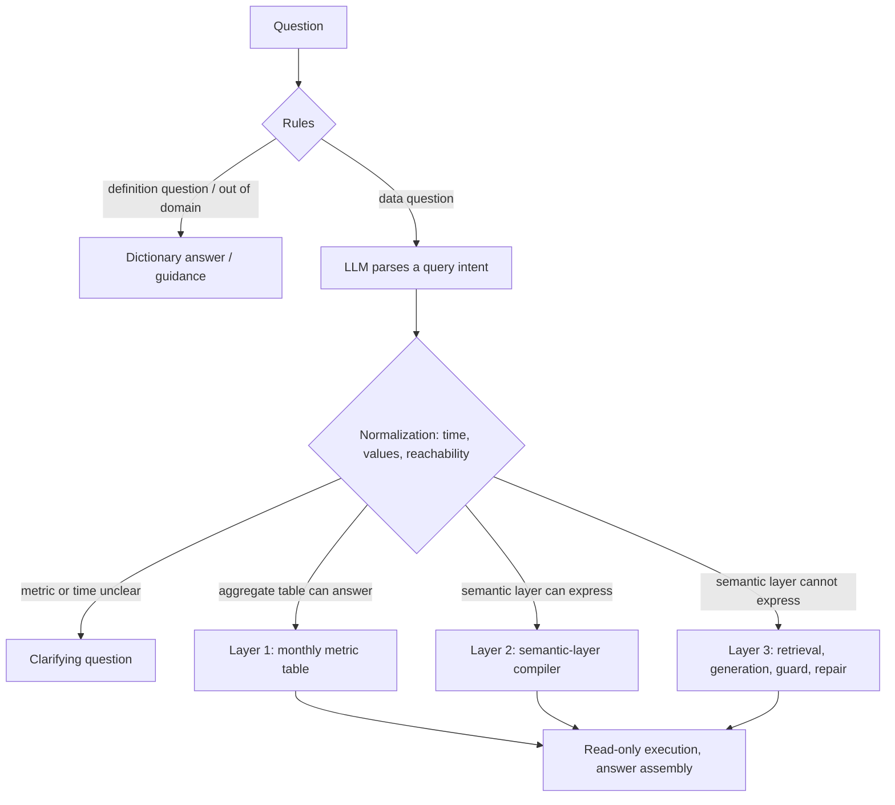

# Tiered Text2SQL for bank risk analytics

[中文](README.md) | English

A Text2SQL system for bank risk analytics. Questions about metrics with fixed definitions, such as risk event counts and bad loan rates, are parsed by the model into a typed query intent and compiled into SQL by code. The long tail the semantic layer cannot express goes to LLM SQL generation behind table retrieval, an AST allow-list, an EXPLAIN dry run and repair by error type. The data is the anonymized PKDD'99 Czech bank data (the financial database in the BIRD benchmark), extended with a risk event table and a monthly metric table.

The assistant answers in Chinese; the design notes and experiment report are in Chinese.


## Results

| Setting | Result |
|---|---|
| In-domain test set, 60 questions (DeepSeek, 3 runs) | Execution accuracy 93.8%; semantic-layer path 100%, generation path 83.3% |
| Same questions, model writes all SQL directly | 85.4% to 88.2%; 95.8% to 97.2% when format-only differences count as correct |
| BIRD financial, 106 questions (generation path, strict) | DeepSeek 22.0%, Claude Sonnet 5.5 27.4% (single run) |
| Same, with 67 distractor tables mixed in (75 tables) | Original retrieval 14.2%; 21.7% (2 runs) with a multilingual embedding model and the retrieval fixes; table selection and column pruning cut the context to about a quarter without raising accuracy |
| Cost and latency | About 1.35 model calls per question, median latency 1.59 s, at most about USD 0.0003 per question |

The evaluation set was frozen before development; the table reports the first test run, and fixes made after seeing the test results (98.6%) are reported separately. Ignoring format-only differences, direct generation matches the tiered pipeline on numeric accuracy; the difference is reliability. The tiered path gave identical results across three runs on 48 of 48 data questions, direct generation on 44 to 46, and on 6 questions that call for clarification the tiered path answered directly 5.6% of the time against 100% for direct generation. The two BIRD rows measure the generation path only (2025-11 cleaned financial database, strict result-set comparison) and are not comparable with the BIRD leaderboard. Full settings and per-question error analysis are in [docs/EXPERIMENTS.md](docs/EXPERIMENTS.md).

## How it works



Rules handle definition questions, questions unrelated to the data, ambiguous terms and vague time words such as "recently"; simple questions with one metric, a time and a region take a fast path. Neither calls a model. Other questions get one structured parse returning metrics, dimensions, filters and the time phrase as written; code resolves the time range, maps values to database codes and checks reachability and data range. Questions the semantic layer can express are compiled into SQL, and go to the monthly metric table when it can answer.

The remaining questions take the generation path: relevant tables are retrieved with the bridge tables needed to join them, metric definitions, value codes and similar examples go into the prompt, and the model writes the SQL. The SQL passes an AST allow-list and an EXPLAIN dry run, then runs on a read-only connection; on failure, the error type decides whether to rewrite it with the error message, up to three times. Every answer carries the SQL, the metric definition, the period, the data cut-off date and every default the code assumed.

## Design trade-offs

### Common questions never ask the model for SQL

The model only fills in a typed query intent (metrics, dimensions, filters, time phrase); date arithmetic, value codes, join paths and metric definitions live in code and `semantic/*.yaml`. Accuracy on layers 1 and 2 therefore does not depend on the model: given the annotated intents, all 51 questions compile to the gold results, and switching to Claude left both layers unchanged.

### Rules only decide what they are sure of

A rule may abstain but must not be wrong; anything uncertain goes to the model. A quarter of the test questions are settled by rules without a model call. Judging a question unrelated to the data from missing business terms alone misclassifies "how many last month?" and similar questions (60% precision on the rule probe set); also requiring missing data words such as "how many" or "trend" raises it to 89%.

### Aggregate tables must respect additivity

Layer 1 is a table of metrics pre-aggregated by month and region, built by the same compiler as layer 2, so both paths share every metric definition. Code decides whether the table can answer from its dimensions, grain, time alignment and additivity; the model never reads a number. Distinct counts do not add up across months: risky accounts in Q4 1997 sum to 438 over the three months but number 333 distinct, so such metrics spanning months are recomputed from the event table.

### With many tables, finding them comes first

With the 67 tables of BIRD's other 10 dev databases mixed into financial (75 tables), the original retrieval gets every needed table to the model for only 7.5% of the questions, and accuracy falls from 20.8% to 14.2%. Layer 3 gained three schema-linking options that switch on separately: column-level linking (column retrieval, a stored-value index and the semantic layer's dimension names, whose tables join the candidates), table selection by the model (it can only drop tables; code adds back join tables), and column pruning by the model (keys and columns holding a named value are always kept). Adding the tables of matched values raised accuracy to 18.9%. The original embedding model, bge-small-zh, only handles Chinese; with the multilingual bge-m3, questions with every needed table in context rose from 7.5% to 52.8% and the baseline reached 21.7%, the remaining failures being mostly column choice and meaning. Table selection and column pruning cut the context from 6 tables and 69 columns to 4 and 15 without adding accuracy, so all three are off by default.

### Repair fixes errors, not definitions

Generated SQL must pass an AST allow-list before it runs (a single query, only catalog tables); it stopped all 9 attack patterns, a keyword blacklist only 6. On failure the error type decides whether to rewrite; a missing table or a write is not retried. Repair helps little: on BIRD about 8% of attempts needed repair and only 2 of 25 succeeded, since most failing queries run and simply return the wrong answer. Claude, when information is missing, writes a placeholder query that always returns nothing; an empty result does not trigger repair, so the error-driven schema widening never starts.

More design detail is in [docs/DESIGN.md](docs/DESIGN.md).

## Limitations

Routing is the main source of failure: of the 3 test questions answered wrongly in every run, two answerable questions were classified as unrelated to the data, and one forced a table the semantic layer does not cover into an existing metric. The evaluation set has only 101 questions written by one person, and its test split has been looked at many times, so further work needs a new held-out set. Most hard BIRD questions ask for many output columns and rarely score under strict comparison. The post-hoc large-schema results have 1 or 2 runs per configuration, and two runs of one configuration can differ by 4 questions. Placeholder queries are not yet detected.

## Quick start

Requires Python 3.12 and [uv](https://docs.astral.sh/uv/).

```bash
uv sync --extra app                           # dependencies, including Streamlit
uv run python scripts/download_data.py        # BIRD financial database and cleaned questions (a 346 MB archive)
uv run python scripts/build_warehouse.py      # risk event table and monthly metric table
cp .env.example .env                          # set DEEPSEEK_API_KEY; the model comparison also needs ANTHROPIC_API_KEY

uv run t2s ask "1998年11月的风险事件数是多少？"
uv run t2s chat                               # interactive, clarifying questions can be answered in place
uv run --extra app streamlit run app/streamlit_app.py --server.address localhost
uv run --group dev pytest -q
uv run python scripts/run_eval.py --mode oracle --split all   # compile and execute annotated intents, no model calls
uv run python scripts/build_distractors.py    # optional: distractor tables for the large-schema evaluation (downloads the 346 MB BIRD dev archive again)
```

Without an API key, questions the rules can handle still get answers; `--provider none` turns the model off explicitly. Evaluation runs through `scripts/run_eval.py`, for example `--split test --repeats 3 --name x1_test`, and `scripts/summarize_runs.py` writes the results into the experiment report.

## Layout

```text
semantic/            semantic layer: table and column catalog, joins and dimension values, 18 metric definitions
src/text2sql/
  semantic/          semantic model, query intent, time parsing, value linking, compiler, aggregate table
  pipeline/          rules, parsing, normalization, routing, layer 3, answers, workflow
  knowledge/         table and column retrieval (BM25, embeddings, RRF fusion, join completion), stored-value index
  db/                read-only executor and SQL guard
  llm/               DeepSeek and Claude clients
  eval/              dataset loading, execution-accuracy comparison, metrics and cost
app/                 Streamlit app
eval/                in-domain evaluation set and rule probes
scripts/             download, warehouse build, evaluation and report generation
```

Design notes are in [docs/DESIGN.md](docs/DESIGN.md), the experiment report in [docs/EXPERIMENTS.md](docs/EXPERIMENTS.md), the data profile in [docs/DATA_PROFILE.md](docs/DATA_PROFILE.md), and the evaluation set and scoring rules in [eval/README.md](eval/README.md).

## Data and licenses

Code and documents are under the MIT License, see [LICENSE](LICENSE). The data is the [BIRD](https://bird-bench.github.io/) financial database (from the PKDD'99 Discovery Challenge) and the cleaned questions of 2025-11-06, under CC BY-SA 4.0; both are downloaded by script and not redistributed here. The embedding model is [BAAI/bge-m3](https://huggingface.co/BAAI/bge-m3) by default (MIT, about 2.3 GB, its official ONNX export downloaded on first use); `EMBEDDING_MODEL=bge-small-zh` switches to [BAAI/bge-small-zh-v1.5](https://huggingface.co/BAAI/bge-small-zh-v1.5) (MIT, about 90 MB).
