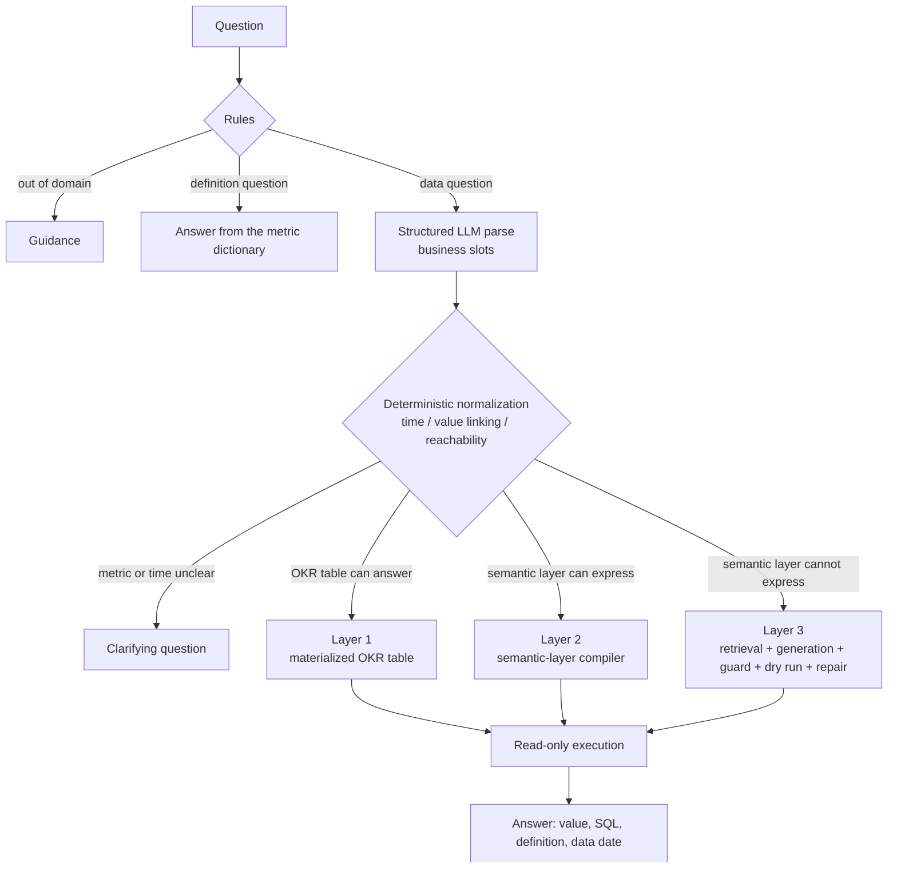

# Tiered Text2SQL: a Data Assistant for Bank Risk Analytics

[中文](README.md) | English

A Text2SQL system for bank risk analytics that puts the semantic layer first and falls back to generation. Common questions are parsed by a model into business slots and compiled into SQL deterministically by the semantic layer; only questions the semantic layer cannot express go to LLM SQL generation, guarded by retrieval, an AST guard, EXPLAIN dry runs and typed repair. The data is the real, anonymized PKDD'99 Czech bank data (BIRD financial), on top of which a risk-event table and a monthly OKR metric table are built.

The assistant answers in Chinese, and the detailed documents (plan, experiment report, evaluation notes) are written in Chinese.

## 1. Architecture



Questions the rules can settle (one metric, a clear time and region) take a fast path with no model call. Layers 1 and 2 generate SQL from one set of semantic-layer definitions; the model neither writes SQL nor reads numbers.

## 2. Results

The in-domain evaluation set has 101 questions (dev 41 / test 60) and was frozen before development; the 106 BIRD financial questions serve as an external benchmark for layer 3. The default model is DeepSeek deepseek-flash, and each experiment runs 3 times. Full tables and error analysis are in [docs/EXPERIMENTS.md](docs/EXPERIMENTS.md).

| Experiment | Setting | Result |
|---|---|---|
| X1 end to end | in-domain test, 60 questions | Execution accuracy 93.8% (identical over 3 runs); layers 1 and 2: 100%, layer 3: 83.3%; routing accuracy 94.4%; median latency 1.59 s; cost at most about USD 0.0003 per question. Every failure came from routing; a version fixed after seeing test scores 98.6% and is reported separately, never replacing the official score |
| X2 tiered vs direct generation | 48 data questions from test | Execution accuracy: tiered 93.8%, the same layer 3 for every question 85.4%, naive baseline 88.2%; counting format-only differences as correct: 93.8% / 95.8% / 97.2%. Identical results across 3 runs: 48/48, 46/48, 44/48; on 6 questions that need clarification, share answered without asking: 5.6% / 100% / 100% |
| X3 layer-3 ablation | BIRD, 106 questions, strict | Full layer 3: 22.0% (simple 50.0%, moderate 37.3%, challenging 3.5%); without examples 17.9%, without repair 21.1%. For 50 of the 57 challenging questions the gold result has more than 5 columns |
| X4 schema | as X3 | Full schema 22.0%, BM25 21.7%, vector 21.1%, hybrid 22.0%; questions with every needed table retrieved: 106, 78, 67, 73 |
| X5 models | Claude Sonnet 5.5, single run | In-domain test 97.9% (all of the gain from routing); BIRD 27.4% (31.1% with the full schema); about 18 to 20 times the cost and about twice the latency |

Findings:

1. With 10 tables, direct generation is about as accurate numerically as the tiered pipeline; the semantic layer pays off in the same result every time, definitions and relative time guaranteed by code, and clarifying questions for ambiguous requests.
2. Accuracy on layers 1 and 2 does not depend on the model; a stronger model helps routing and layer 3.
3. Repair fixes errors, not definitions; differences in retrieval recall did not turn into differences in accuracy, as most failures lie in column choice and value semantics.
4. When information is missing, the stronger model writes placeholder queries that always return nothing, which bypasses the schema widening triggered by errors; the fix is on the follow-up list.

The BIRD results use the 2025-11 cleaned financial database alone with strict comparison, and layer 3 sees only retrieved tables by default, so they are not comparable with the BIRD leaderboard.

## 3. Demo

Streamlit app: a chat in which metric and time clarifications can be answered in place, and each answer folds out its trace (step timings, SQL, IR, model calls and a cost ceiling). Below, an answer from layer 3:


Command line (rule fast path, no model call):

```text
$ uv run t2s --provider none --trace ask "1997年第四季度南摩拉维亚的风险账户数是多少？"
╭──────────────────────── 第二层 语义层编译 · 快速通道 ────────────────────────╮
│ 1997-10-01 至 1997-12-31：风险账户数 56户。                                  │
│                                                                              │
│ 路由：第二层：语义层编译 SQL                                                 │
│ 时间范围：1997-10-01 至 1997-12-31；数据截至 1998-12-31                      │
│ 口径：风险账户数：统计期内至少命中一次监测规则的去重账户数。去重计数不可加。 │
│ 筛选：地区 = 南摩拉维亚                                                      │
╰──────────────────────────────────────────────────────────────────────────────╯
┏━━━━━━━━━━━━┓
┃ 风险账户数 ┃
┡━━━━━━━━━━━━┩
│ 56         │
└────────────┘
╭───────────────────────────────── SQL ─────────────────────────────────╮
│ SELECT COUNT(DISTINCT dwd_risk_event.account_id) AS risk_account_cnt  │
│ FROM dwd_risk_event                                                   │
│ JOIN district ON dwd_risk_event.district_id = district.district_id    │
│ WHERE district.A3 IN ('south Moravia')                                │
│   AND dwd_risk_event.event_date BETWEEN '1997-10-01' AND '1997-12-31' │
╰───────────────────────────────────────────────────────────────────────╯
  route           0.3 ms  L2（fast_path）：单指标简单问题，规则完成解析
  compile         2.7 ms  1 条 SQL（L2）
  execute         1.0 ms  成功
  总耗时 0.00s；LLM 调用 0 次；token 0+0
```

The question asks for risky accounts in Q4 1997 in South Moravia. A distinct count cannot be summed over three monthly values, so this question skips the monthly materialized table of layer 1 and is computed from the risk-event table.

## 4. Quick start

Requires Python 3.12 and [uv](https://docs.astral.sh/uv/).

```bash
uv sync --extra app                          # dependencies, including Streamlit
uv run python scripts/download_data.py       # BIRD financial database and cleaned questions (a 346 MB archive; only the needed files are kept)
uv run python scripts/build_warehouse.py     # risk-event table and monthly OKR table
cp .env.example .env                         # set DEEPSEEK_API_KEY; the model comparison also needs ANTHROPIC_API_KEY
```

```bash
uv run t2s ask "1998年11月的风险事件数是多少？"     # one question
uv run t2s chat                                      # interactive, clarifications answered in place
uv run --extra app streamlit run app/streamlit_app.py --server.address localhost   # demo app
uv run --group dev pytest -q                         # tests
uv run python scripts/run_eval.py --mode oracle --split all   # decoupled evaluation from gold IR, no model needed
```

Without an API key, questions the rules can settle (definition questions, the fast path) still get answers; `--provider none` turns the model off explicitly. Live evaluation runs through `scripts/run_eval.py` (for example `uv run python scripts/run_eval.py --split test --repeats 3 --name x1_test`), and `scripts/summarize_runs.py` writes the report tables; see [docs/EXPERIMENTS.md](docs/EXPERIMENTS.md) for what each experiment cost.

## 5. Design highlights

1. **The model outputs business slots; the semantic layer compiles SQL.** Metric definitions, dimension values and join paths live in `semantic/*.yaml`, the compiler fills parameterized templates per query type, and user input is only ever a bound parameter. Layers 1 and 2 score 100% with both models; the decoupled evaluation from gold IR gets all 51 questions right.
2. **Rules first, the model second.** Rules only make decisions they are sure of (definition questions, out of domain, ambiguous terms, vague time, fast path): they may abstain, never misjudge. In X1, 25% of questions need no model call. Relative time is resolved by rules from the reference date; under direct generation the model computed "last month" from today's real date and got nothing.
3. **Layer 1 is a materialized cache of the semantic layer.** The OKR table is built by the layer-2 compiler, so both layers share definitions by construction. Distinct counts do not add across months: risky accounts in Q4 1997 sum to 438 over monthly values but are 333 distinct, so such questions go back to the base table.
4. **Value linking and clarification.** Business wording is translated into database codes; without it, "cash withdrawals in South Moravia in 1998" returns 0 instead of 22,550. When a metric is ambiguous or the time is unclear, the system asks, and both the command line and the app accept the answer in place, for up to 3 rounds.
5. **Safety and repair in layer 3.** An sqlglot AST allow-list guard stops all 9 attack patterns tried (a keyword blacklist stops 6) and blocks none of the 187 gold SQL statements; read-only connections; EXPLAIN dry runs; repair by error type, at most 3 times, with no retry for unrecoverable errors.
6. **Evaluation discipline.** The evaluation set was frozen before development; the first test run is the official score and later changes are reported separately; each experiment runs 3 times; report tables are generated by scripts from the run outputs.

## 6. Layout

```text
semantic/        semantic layer: catalog.yaml (tables, columns), dimensions.yaml (relations, values), metrics.yaml (18 metrics)
src/text2sql/
  semantic/      semantic model, IR, time parsing, value linking, compiler, OKR materialization
  pipeline/      rules, parsing, normalization, routing, layer-3 generation and repair, answers, workflow
  knowledge/     table retrieval (BM25, vectors, RRF fusion, join completion)
  db/            read-only executor, EXPLAIN dry run, SQL guard
  llm/           DeepSeek and Claude clients behind one interface
  eval/          dataset loading, execution-accuracy comparison, metrics, cost
  cli.py         command line: t2s ask / t2s chat
app/             Streamlit demo
knowledge/       layer-3 SQL examples
eval/            in-domain evaluation set, rule probes, evaluation notes
scripts/         download, warehouse build, evaluation runs and report generation
docs/            plan, data profile, experiment report
tests/           unit and integration tests (no live model calls)
```

## 7. Documents (in Chinese)

| Document | Contents |
|---|---|
| [docs/PLAN.md](docs/PLAN.md) | Plan, architecture and key design decisions |
| [docs/EXPERIMENTS.md](docs/EXPERIMENTS.md) | Experiments X1 to X5: settings, results, error analysis |
| [docs/DATA_PROFILE.md](docs/DATA_PROFILE.md) | Data profile and the basis of the risk-rule thresholds |
| [eval/README.md](eval/README.md) | Evaluation set, conventions and scoring rules |

## 8. Data and licenses

1. Code and documents: MIT License, see [LICENSE](LICENSE).
2. Data: the [BIRD](https://bird-bench.github.io/) financial database (from the PKDD'99 Discovery Challenge Czech bank data) and the cleaned BIRD dev questions of 2025-11-06, CC BY-SA 4.0; downloaded by script and not redistributed in this repository. The risk-event and OKR tables are generated locally by script.
3. Embedding model: [BAAI/bge-small-zh-v1.5](https://huggingface.co/BAAI/bge-small-zh-v1.5) (MIT), downloaded by fastembed on first use.
