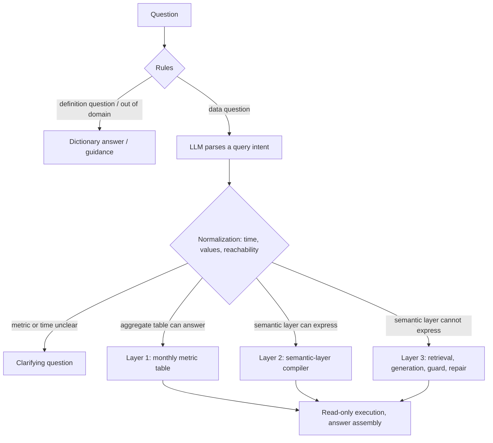

# Tiered Text2SQL for bank risk analytics

[中文](README.md) | English

This is a Text2SQL system for bank risk analytics. The starting point is simple: most questions business users ask are about metrics with fixed definitions, such as risk event counts, bad loan rates and amounts at risk, and those questions should not depend on a model writing SQL from scratch every time. Questions the semantic layer can express are parsed into a typed query intent and compiled into SQL by code. Only the long tail goes to LLM SQL generation, which runs behind table retrieval, an AST allow-list, an EXPLAIN dry run and repair by error type. The data is the real, anonymized PKDD'99 Czech bank data (the financial database in the BIRD benchmark), extended with a risk event table and a monthly metric table.

The assistant answers in Chinese, and the design notes and experiment report are written in Chinese.


## Results

| Setting | Result |
|---|---|
| In-domain test set, 60 questions (DeepSeek, 3 runs) | Execution accuracy 93.8%; semantic-layer path 100%, generation path 83.3% |
| Same questions, model writes all SQL directly | 85.4% to 88.2%; 95.8% to 97.2% when format-only differences count as correct |
| BIRD financial, 106 questions (generation path, strict) | DeepSeek 22.0%, Claude Sonnet 5.5 27.4% (single run) |
| Same, with 67 distractor tables mixed in (75 tables) | Original retrieval 14.2%; value-hit tables added 18.9%; about 20% after fixing English retrieval, with table selection and column pruning cutting the context from 6 tables and 91 columns to 3 and 13 at no loss |
| Cost and latency | About 1.35 model calls per question, median latency 1.59 s, at most about USD 0.0003 per question |

The in-domain evaluation set was frozen before development, and the test split was not looked at during development. The table reports the first test run; fixes made after seeing the test results (98.6%) are reported separately and are not included above. Once format-only differences are ignored, direct generation is no less accurate numerically than the tiered pipeline. The difference is reliability: all 48 data questions gave identical results across three runs on the tiered path, against 44 to 46 for direct generation, and on 6 questions that should trigger a clarifying question the tiered path answered directly 5.6% of the time while direct generation always picked a definition on its own. The BIRD row measures the generation path only, on the 2025-11 cleaned financial database with strict result-set comparison, so it is not comparable with the BIRD leaderboard. Full settings, per-question error analysis and four more experiments (layer-3 ablation, schema retrieval, model comparison, schema linking on a large schema) are in [docs/EXPERIMENTS.md](docs/EXPERIMENTS.md).

## How it works



A question goes through rules first. Definition questions, questions unrelated to the data, ambiguous terms and vague time words such as "recently" are handled by rules, and simple questions with one metric plus a time and a region take a fast path; none of these call a model. Everything else gets one structured parse from the model, which returns metrics, dimensions, filters and the time phrase as written. Code then resolves the time range, maps values to database codes, checks that the dimensions are reachable and that the period lies within the data. Questions the semantic layer can express are compiled into SQL, and if the monthly metric table can answer, the query goes there.

Questions the semantic layer cannot express take the generation path. The relevant tables are retrieved along with the bridge tables needed to join them, metric definitions, value codes and similar examples go into the prompt, and the model writes the SQL. The SQL must pass an AST allow-list and an EXPLAIN dry run before it runs on a read-only connection; on failure, the error type decides whether the model rewrites it with the error message, up to three times. Every answer carries the SQL, the metric definition, the period, the data cut-off date and every default the code assumed on the user's behalf.

## Design trade-offs

### Common questions never ask the model for SQL

For questions the semantic layer can express, the model only fills in a typed query intent: metrics, dimensions, filters and the time phrase. Everything that has to be exactly right, the date arithmetic, value codes, join paths and metric definitions, lives in code and in `semantic/*.yaml`. Accuracy on layers 1 and 2 therefore does not depend on the model: given the annotated intents, all 51 questions compile to the gold results, and switching to Claude left both layers unchanged.

### Rules only decide what they are sure of

A rule may abstain but must not be wrong; anything uncertain goes to the model. A quarter of the test questions are settled at the rule stage without a model call. Deciding that a question is unrelated to the data from the absence of business terms alone misclassifies questions like "how many last month?", with a precision of 60% on the rule probe set; requiring the absence of data words such as "how many" or "trend" as well raises it to 89%.

### Aggregate tables must respect additivity

Layer 1 is a table of metrics pre-aggregated by month and region, built by the same compiler as layer 2, so both paths share one definition of every metric. Whether the table can answer a question is decided by code from its dimensions, grain, time alignment and additivity; the model never reads a number. Additivity is where it goes wrong: the count of risky accounts in Q4 1997 is 438 if the three monthly values are summed, but 333 distinct accounts, so distinct counts that span months are always recomputed from the event table.

### With many tables, finding the right ones comes first

To test a larger schema, the evaluation mixes in the 67 tables of BIRD's other 10 dev databases, 75 tables in all. The original retrieval then gets every needed table to the model for only 7.5% of the questions, and accuracy falls from 20.8% to 14.2%. Layer 3 gained three schema-linking options that can be switched on separately: column-level linking (column retrieval, an index of stored values, and the semantic layer's dimension names, whose tables join the candidates), table selection by the model (it can only drop tables; code adds back the tables needed for joins), and column pruning by the model (keys and the columns holding a named value are always kept). Adding the tables of matched values raised accuracy to 18.9%. A closer look showed that the embedding model only handles Chinese, so its ranking of English questions is noise; ranking English questions by BM25 alone, with plurals folded, brought the baseline back to about 20%. Table selection and column pruning cut the context handed to generation from 6 tables and 91 columns to 3 and 13 without losing coverage or accuracy, but did not add accuracy either, so all three stay off by default.

### Repair fixes errors, not definitions

Generated SQL has to pass an AST allow-list before it runs (a single query, only tables in the catalog); on 9 attack patterns the allow-list stopped all of them, a keyword blacklist only 6. When execution fails, the error type decides whether to rewrite, and errors such as a missing table or a write are not retried. Repair helps less than one might hope: on BIRD about 8% of attempts needed repair and only 2 of 25 repairs succeeded, because most failing queries run fine and simply return the wrong answer. The model comparison also showed that Claude, when information is missing, writes a placeholder query that always returns nothing; an empty result does not trigger repair, so the schema widening that relies on errors never kicks in.

More design detail is in [docs/DESIGN.md](docs/DESIGN.md).

## Limitations

Routing is the main source of failure: of the 3 test questions answered wrongly in every run, two were answerable questions classified as unrelated to the data, and one forced a table the semantic layer does not cover into an existing metric. The in-domain evaluation set has only 101 questions written by one person, and its test split has now been looked at many times, so further work needs a new held-out set. Most hard BIRD questions ask for many output columns and are difficult to score under strict comparison. The embedding model used for retrieval only handles Chinese, so English questions rely on BM25 alone. Detection of placeholder queries is not implemented yet.

## Quick start

Requires Python 3.12 and [uv](https://docs.astral.sh/uv/).

```bash
uv sync --extra app                           # dependencies, including Streamlit
uv run python scripts/download_data.py        # BIRD financial database and cleaned questions (a 346 MB archive)
uv run python scripts/build_warehouse.py      # risk event table and monthly metric table
cp .env.example .env                          # set DEEPSEEK_API_KEY; the model comparison also needs ANTHROPIC_API_KEY

uv run t2s ask "1998年11月的风险事件数是多少？"
uv run t2s chat                               # interactive, clarifying questions can be answered in place
uv run --extra app streamlit run app/streamlit_app.py --server.address localhost
uv run --group dev pytest -q
uv run python scripts/run_eval.py --mode oracle --split all   # compile and execute annotated intents, no model calls
uv run python scripts/build_distractors.py    # optional: distractor tables for the large-schema evaluation (downloads the 346 MB BIRD dev archive again)
```

Without an API key, questions the rules can handle still get answers; `--provider none` turns the model off explicitly. Evaluation runs through `scripts/run_eval.py`, for example `--split test --repeats 3 --name x1_test`, and `scripts/summarize_runs.py` writes the results into the experiment report.

## Layout

```text
semantic/            semantic layer: table and column catalog, joins and dimension values, 18 metric definitions
src/text2sql/
  semantic/          semantic model, query intent, time parsing, value linking, compiler, aggregate table
  pipeline/          rules, parsing, normalization, routing, layer 3, answers, workflow
  knowledge/         table and column retrieval (BM25, embeddings, RRF fusion, join completion), stored-value index
  db/                read-only executor and SQL guard
  llm/               DeepSeek and Claude clients
  eval/              dataset loading, execution-accuracy comparison, metrics and cost
app/                 Streamlit app
eval/                in-domain evaluation set and rule probes
scripts/             download, warehouse build, evaluation and report generation
```

Design notes are in [docs/DESIGN.md](docs/DESIGN.md), the experiment report in [docs/EXPERIMENTS.md](docs/EXPERIMENTS.md), the data profile in [docs/DATA_PROFILE.md](docs/DATA_PROFILE.md), and the evaluation set and scoring rules in [eval/README.md](eval/README.md).

## Data and licenses

Code and documents are under the MIT License, see [LICENSE](LICENSE). The data is the [BIRD](https://bird-bench.github.io/) financial database (from the PKDD'99 Discovery Challenge) and the cleaned questions of 2025-11-06, under CC BY-SA 4.0; both are downloaded by script and not redistributed here. The embedding model is [BAAI/bge-small-zh-v1.5](https://huggingface.co/BAAI/bge-small-zh-v1.5) (MIT), downloaded by fastembed on first use.
