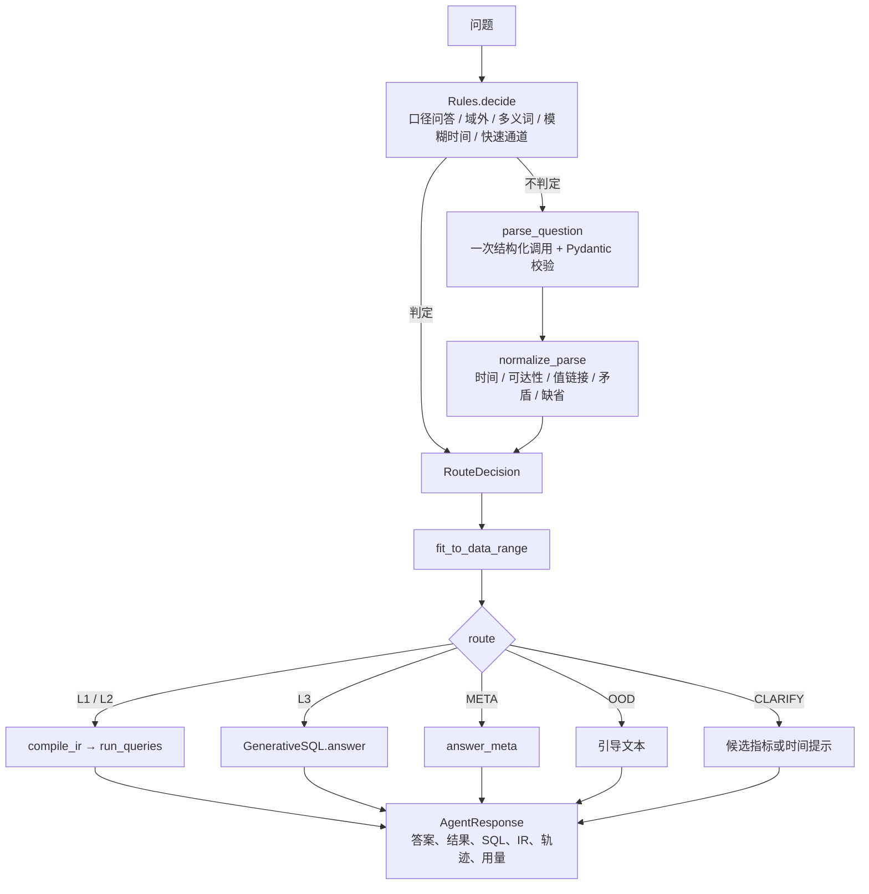

# 工程文档

本文档说明系统的模块划分、数据结构、处理流程、配置、评估与扩展方法，面向需要阅读、运行或修改代码的开发者。设计取舍与实验证据见 [PLAN.md](PLAN.md) 与 [EXPERIMENTS.md](EXPERIMENTS.md)；评估集约定见 [eval/README.md](../eval/README.md)。

## 1. 系统概览

### 1.1 范围

| 纳入 | 不纳入 |
|---|---|
| 规则加一次模型解析的路由；第一层 OKR 物化表；第二层语义层编译；第三层检索加生成加纠错；澄清、兜底、口径问答；只读执行与 SQL 护栏；命令行与 Streamlit；自建评估集与 BIRD 基准评估 | 模型微调；多候选生成与投票；开放式多轮对话；真实权限系统（以只读连接与护栏模拟）；生产部署 |

### 1.2 模块

| 包 | 职责 |
|---|---|
| `semantic/`（仓库根目录） | 语义层 YAML：物理字典、关联关系与维度取值、指标口径 |
| `src/text2sql/semantic/` | 语义模型加载、IR、时间解析、值链接、IR 编译、第一层判定、OKR 物化 |
| `src/text2sql/pipeline/` | 规则、解析、规范化、路由调度、第三层、口径问答、答案组装、总结、工作流 |
| `src/text2sql/knowledge/` | 表级知识单元、BM25、向量、混合检索、示例库 |
| `src/text2sql/db/` | 只读执行器、EXPLAIN 干跑、错误分类、SQL 护栏 |
| `src/text2sql/llm/` | 统一模型接口与 DeepSeek、Claude 客户端 |
| `src/text2sql/eval/` | 评估集加载、执行准确率比较、指标、运行器、费用、报告表格 |
| `src/text2sql/cli.py`、`app/` | 命令行与 Streamlit 界面 |
| `scripts/` | 数据下载、数仓构建、评估运行、报告生成与校验 |

### 1.3 一次请求的处理流程



`Text2SQLAgent.ask`（`pipeline/workflow.py`）是唯一入口：先路由，再按路由分派到一个处理分支。每一步写入轨迹（`TraceStep`：名称、说明、耗时）。

## 2. 运行环境与配置

### 2.1 环境

| 项 | 要求 |
|---|---|
| Python | 3.12（`.python-version`），`requires-python >= 3.11` |
| 依赖管理 | uv；`uv sync --extra app` 安装运行依赖、Streamlit 与开发依赖 |
| 主要依赖 | openai（DeepSeek）、anthropic、pydantic、pyyaml、jinja2、sqlglot、fastembed、numpy、rich、python-dotenv；可选 streamlit；开发 pytest |
| 数据库 | SQLite，只读打开 |

### 2.2 文件与目录

| 路径 | 内容 | 来源 |
|---|---|---|
| `data/financial.sqlite` | BIRD financial 原始库（8 张表），BIRD 基准在此执行 | `scripts/download_data.py` |
| `data/bank_risk.sqlite` | 原始 8 张表加风险事件表与月度 OKR 表，系统默认库 | `scripts/build_warehouse.py` |
| `data/bird_financial_description/` | BIRD 英文字段说明 CSV，用于检索文档 | 下载脚本 |
| `data/raw/bird_dev_20251106.json` | BIRD 2025-11-06 清洗版题目 | 下载脚本 |
| `.cache/fastembed/` | 向量模型 bge-small-zh-v1.5（约 90 MB），首次使用时下载 | fastembed |
| `runs/<name>/` | 每次评估的 `metrics.json` 与 `predictions.jsonl` | `scripts/run_eval.py` |

`data/`、`.cache/`、`runs/`、`.env` 均不入库。

### 2.3 配置项

`src/text2sql/config.py` 在导入时读取 `.env`（模板为 `.env.example`）。

| 变量 | 默认值 | 作用 |
|---|---|---|
| `LLM_PROVIDER` | deepseek | 默认模型提供方（deepseek 或 claude） |
| `DEEPSEEK_API_KEY` | 无 | DeepSeek 密钥 |
| `DEEPSEEK_MODEL` | deepseek-flash | DeepSeek 模型 |
| `DEEPSEEK_THINKING_FOR_GENERATE` | 0 | 为 1 时第三层生成开启 DeepSeek 思考模式 |
| `ANTHROPIC_API_KEY` | 无 | Claude 密钥（由 Anthropic SDK 读取） |
| `CLAUDE_MODEL` | claude-sonnet-5-5 | Claude 模型 |
| `SQL_TIMEOUT_S` | 10 | 单条 SQL 执行超时（秒） |
| `MAX_ROWS` | 1000 | 展示用的行数上限 |
| `EVAL_MAX_ROWS` | 50000 | 评估用的行数上限（BIRD 金标最大 15,140 行） |
| `MAX_REPAIR_ATTEMPTS` | 3 | 第三层最多修复次数 |

代码常量：参考日期 `REFERENCE_DATE = 1998-12-31`（"上个月""今年以来"据此换算），数据范围 `DATA_START_DATE = 1993-01-01` 至 `DATA_END_DATE = 1998-12-31`。

## 3. 数据层

### 3.1 获取

`scripts/download_data.py` 下载 BIRD dev 压缩包（约 346 MB），只保留 `financial.sqlite` 与其字段说明，其余删除；另从 Hugging Face 下载清洗版题目。

### 3.2 数仓构建

`scripts/build_warehouse.py` 依次执行：

1. 复制 `financial.sqlite` 为 `bank_risk.sqlite`（ODS 层，内容不改）。
2. 建索引（交易的账户与日期、日期，账户的区县，贷款、权限关系、卡、代扣指令的关联键）。
3. 生成 DWD 风险事件表 `dwd_risk_event`，三条规则，阈值依据见 [DATA_PROFILE.md](DATA_PROFILE.md)：

| 规则编码 | 名称 | 条件 | 风险大类 |
|---|---|---|---|
| `LARGE_CASH` | 大额现金取现 | 现金取现（`operation = 'VYBER'`）单笔不低于 50,000 | AML |
| `RAPID_IN_OUT` | 快进快出 | 单笔入账不低于 30,000，且当日起 3 天内同账户出账累计不低于该笔入账的 90% | AML |
| `OVERDRAFT_PENALTY` | 透支罚息 | 因负余额计收的罚息（`k_symbol = 'SANKC. UROK'`） | CREDIT |

4. 建事件表索引并 `ANALYZE`。
5. 调用 `materialize_okr` 生成 ADS 月度 OKR 表 `ads_okr_monthly`（见 6.3 节）。

构建结果：风险事件 8,625 条，OKR 表 3,848 行。

### 3.3 表清单

| 表 | 层 | 粒度 |
|---|---|---|
| account | ODS | 每行一个账户，4,500 个 |
| client | ODS | 每行一个客户，5,369 个 |
| disp | ODS | 每行一个客户对一个账户的权限关系，5,369 条（OWNER 4,500、DISPONENT 869） |
| card | ODS | 每行一张卡，892 张 |
| loan | ODS | 每行一笔贷款，682 笔 |
| order | ODS | 每行一条长期代付指令，6,471 条；表名为 SQL 保留字，须加引号 |
| trans | ODS | 每行一笔交易，1,056,320 笔 |
| district | ODS | 每行一个区县，77 个，含人口、工资、失业率、犯罪数等属性（A2 至 A16） |
| dwd_risk_event | DWD | 每行一次规则命中，8,625 条 |
| ads_okr_monthly | ADS | 每行一个月份、一个地区（含 ALL）、一个指标 |

数据质量注意点：`trans.type` 存在未文档化的 VYBER；`k_symbol` 缺失有 NULL 与单个空格两种写法；`district.A4` 至 `A7` 为文本型数字。

## 4. 语义层

### 4.1 文件

| 文件 | 内容 | 主要使用者 |
|---|---|---|
| `semantic/catalog.yaml` | `tables`（每张表的中文名、层、粒度、说明、注意事项、字段）与 `foreign_keys` | 第三层表结构渲染、检索文档、口径问答、外键关系图 |
| `semantic/dimensions.yaml` | `join_graph`（多对一关联边）、`time_grains`（日、月、季度、年的 SQL 模版）、`dimensions`（维度、所在列、取值编码、中文名与别名） | 编译器寻路、值链接、解析提示 |
| `semantic/metrics.yaml` | `metrics`（18 个指标的口径）与 `ambiguous_terms`（多义词与候选指标） | 编译器、物化、规则、解析提示、口径问答 |

三份文件是口径的单一事实源：第一层物化、第二层编译、第三层口径注入、口径问答都从这里生成。

### 4.2 字段说明

**表字段**（catalog.yaml，`tables.<table>.columns.<column>`）

| 键 | 含义 |
|---|---|
| `type` | 数据类型 |
| `name_zh` | 中文名 |
| `description` | 说明；形如"关联 district.district_id"的文字用于构建外键关系图 |
| `dimension` | 该列对应的维度编码（可选），第三层表结构据此显示取值编码 |

**关联边**（dimensions.yaml，`join_graph`）：`from`、`to`、`condition`，以及 `to` 为别名时的物理表 `table`。全部为多对一方向。账户所有人通过 `owner_disp`（`disp` 限定 `type = 'OWNER'`）与 `owner_client` 两个别名表达，保证一对一。

**维度**（dimensions.yaml，`dimensions.<key>`）

| 键 | 含义 |
|---|---|
| `name`、`aliases` | 维度名与别名 |
| `column` | `<表或别名>.<列>` |
| `values` | 取值列表，每项为 `code`（或 `codes`）、`label`（中文名）、`aliases` |

共 12 个维度：地区、区县、资金方向、交易方式、交易用途、贷款状态、贷款期限、账单频率、卡类型、户主性别、风险规则、风险大类。

**指标**（metrics.yaml，`metrics.<key>`）

| 键 | 含义 |
|---|---|
| `name`、`aliases`、`domain` | 名称、别名、业务域 |
| `table`、`time_column` | 基表与统计时间列 |
| `agg` | `count`（可加）、`sum`（可加）、`count_distinct`（不可加，月值不能累加）、`ratio`（分子分母指标相除） |
| `column` | 聚合列（sum 与 count_distinct） |
| `filters` | 口径条件，编译时与用户筛选合并 |
| `numerator`、`denominator` | 比率指标的分子、分母指标编码 |
| `okr` | 为 true 时物化到 OKR 表 |
| `unit`、`description` | 单位与口径说明 |

18 个指标：交易笔数、交易金额、入账金额、出账金额、现金取现金额、现金取现笔数、活跃账户数、笔均交易金额、新开户数、发卡量、放款笔数、放款金额、不良贷款笔数、不良贷款金额、不良率、风险事件数、风险账户数、风险涉及金额；其中 9 个为 OKR 指标。多义词 5 个：损失、交易量、贷款规模、账户数、风险情况。

### 4.3 语义模型

`load_semantic_model()`（`semantic/registry.py`）把三份 YAML 读成 Pydantic 对象 `SemanticModel`，并缓存。主要方法：

| 方法 | 作用 |
|---|---|
| `physical_table(alias)` | 别名到物理表 |
| `join_path(base, target)` | 沿多对一边的最短关联路径（广度优先），走不到返回 None |
| `reachable_dimensions(metric)` | 指标可切分的维度 |
| `component_metrics(metric)` | 比率指标的分子分母 |
| `base_metric(key)` | 带口径条件的指标对应的基础指标（如现金取现金额对应交易金额） |
| `okr_metrics()` | OKR 指标列表 |
| `restricted_to(tables)` | 只保留给定表的子模型（BIRD 评估只用原始 8 张表） |
| `uncovered_tables()` | 语义层没有任何指标覆盖的表（代扣指令表、权限关系表等） |
| `validate_references()` | 校验 YAML 之间的引用是否一致 |

## 5. 路由

### 5.1 入口与返回值

`Text2SQLAgent(llm=None, db_path=RISK_DB_PATH, model=None, layer3=None, use_fast_path=True, max_rows=None)`。没有模型时只能回答规则可判定的问题，第三层不启用。

`AgentResponse` 字段：

| 字段 | 含义 |
|---|---|
| `question` | 实际查询的问题（澄清追问后为改写后的问题） |
| `route`、`source` | 路由（L1、L2、L3、CLARIFY、OOD、META）与判定来源（rule、fast_path、llm）；路由失败时为 None |
| `answer` | 完整答案文本 |
| `columns`、`rows` | 原始结果（供评估） |
| `display_columns`、`display_rows` | 格式化后的结果（中文表头、千分位、百分比） |
| `sql` | 执行的 SQL（可能多条） |
| `ir` | 第一、二层的 IR |
| `clarify_kind`、`clarify_options` | 澄清类型（metric 或 time）与候选指标 |
| `assumptions` | 代码替用户做的全部假设，写入答案 |
| `trace`、`usage`、`attempts`、`latency_s` | 轨迹、模型用量、第三层生成次数、总耗时 |
| `error` | 失败原因；不为空时界面显示"未完成" |

`RouteDecision`（`pipeline/decision.py`）在路由各环节之间传递：`route`、`source`、`reason`、`ir`、`parse`、`clarify_kind`、`clarify_options`、`assumptions`、`time_hint`（交给第三层的已换算时间）、`parse_problems`（解析不合格原因）、`usage`。

### 5.2 调度

`Router.route`（`pipeline/router.py`）：先 `Rules.decide`；返回 None 时调用 `parse_question`，再 `normalize_parse`；解析两次都不合格则转澄清；最后对所有路径执行 `fit_to_data_range`。规则不能判定且没有模型时抛出 `LLMError`，工作流将其转为"路由失败"的回答。

### 5.3 规则预判

`Rules.decide`（`pipeline/rules.py`）按顺序判断，任何一步不确定都返回 None：

1. 口径问答：命中口径词（怎么算、口径、哪张表等）且没有取数词。
2. 域外：既无领域词（由语义层的指标、维度、取值名称与别名自动生成，另加通用业务词）也无取数词。
3. 多义词：命中 `ambiguous_terms`，且没有被更长的明确指标名覆盖，转指标类澄清。
4. 模糊时间：问题中没有可解析的时间，却有"最近""目前"等词，转时间类澄清。
5. 快速通道：恰好一个指标，剔除指标、时间与地区取值后只剩虚词，直接生成单值 IR。

### 5.4 结构化解析

`parse_question`（`pipeline/parser.py`）发送一次带 JSON Schema 的调用。系统提示（`pipeline/prompts.py`）包含全部指标与维度、多义词、解析规则和 8 个示例，内容固定，以利用服务端前缀缓存。

`ParseResult` 字段按输出顺序：`intent`（data_query、metadata、out_of_domain）、`metrics`、`time_text`、`dimensions`、`filters`（维度加取值原文）、`query_type`、`grain`、`compare`、`order`、`limit`、`status`（covered、uncovered、clarify）、`reason`。

校验：指标与维度编码必须在语义层内；`limit >= 1`；取数问题必须给出 `status`；`status = covered` 时必须给出 `query_type`。不合格时把逐条错误说明（`describe_errors`）附在提示后重试一次；第二次仍不合格返回 None，路由转澄清，不合格原因记入轨迹。

### 5.5 规范化

`normalize_parse`（`pipeline/normalize.py`）依次处理：

1. 意图与状态：口径问答、域外、需要澄清、未覆盖先分流。问题提到语义层未覆盖的表时，即使模型判为可表达，也转第三层。
2. 时间：可表达的问题以规则从原文解析的结果为准；原文有多个时间时，由模型摘录挑选；解析不了或无法确定时转时间类澄清。不可表达的问题只把模型摘录换算后作为第三层提示。
3. 可达性：维度必须是所有指标都能到达的维度，否则转第三层。
4. 值链接：在指定维度链接失败时，在可达维度中唯一命中则纠正并注明，否则转第三层。
5. 矛盾：指标自带条件与同一列上的用户筛选没有交集时（结果必为 0），转指标类澄清，候选为对应的基础指标。逐期对比（对比查询加"每月"等粒度词）转第三层。
6. 缺省：趋势粒度按粒度词推断，推断不出按月；模型未给出对比方式时，问题含"环比"取环比，否则取同比；有 TopN 没有方向时按降序；未指定时间时统计全部历史。每个缺省都写入 `assumptions`。

`fit_to_data_range`：所问时间完全超出数据范围时转时间类澄清，不查询；部分重叠时裁剪并注明；对比基期在数据范围之前时注明无法计算变化率。

### 5.6 时间解析

`semantic/timeparse.py` 把中文时间表达换算为闭区间，规则按固定顺序匹配，先匹配者生效：

1. 今年以来、近 N 个月（含当月）、近半年、近 N 年、近 N 天、近 N 周。
2. 显式区间：日期到日期、月到月、季度到季度、年到年。
3. 单个单位，从细到粗：日期、上下半年、季度、Q1 写法、月、年。
4. 相对周期：上季度、本季度、上个月、本月、上半年、下半年、前天、昨天、今天。

约定：上个月、上季度、去年为自然周期；两位年份取离参考年份最近的世纪；环比基期中整月区间按月平移，其余按天数平移；同比遇 2 月 29 日取 2 月 28 日；全角数字与中文数字先规范化。"最近""目前"等模糊词不猜，由调用方发起澄清。

### 5.7 值链接

`link_value`（`semantic/linker.py`）把一个取值短语映射为某个维度的编码：先按规范化键（忽略大小写、空格、连字符、下划线、点）等值匹配中文名、别名与编码；不中时计算字符相似度，只有唯一最优且不低于 0.85 时接受，并在答案中注明。词条按固定顺序遍历，保证结果与说明可复现。

### 5.8 IR

`QueryIR`（`semantic/ir.py`）：`metrics`（至少一个）、`query_type`（point、breakdown、trend、compare）、`time_range`（闭区间，None 表示不限）、`grain`、`dimensions`（分组维度）、`filters`（维度到已链接编码）、`compare`（yoy、mom）、`order`、`limit`。模型从不输出表名、关联或分区。

## 6. 第一层与第二层

### 6.1 编译器

`compile_l2`（`semantic/compiler.py`）按基表分组指标，每张基表生成一条 `CompiledQuery`（SQL、参数、层、指标、键列、输出列）；多条结果由 `run_queries`（`pipeline/semantic.py`）按键列合并。

1. 模版：`semantic/templates/` 下 `point`、`breakdown`、`trend`、`compare` 四个 Jinja2 模版，共用 `_from.sql.j2`（FROM、JOIN、WHERE）。
2. 参数：用户的取值与日期只以 `:p0` 形式的参数出现，由驱动绑定。
3. 关联：只沿 `join_graph` 的多对一边寻路，到达分组与筛选维度所在的表；走不到时抛出 `CompileError`。
4. 口径条件：所有指标条件相同时放入 WHERE；不同时每个指标用自己的条件聚合（`SUM(CASE WHEN ...)` 形式）。
5. 比率：分子之和除以分母之和，分母为 0 返回 NULL。
6. 对比：一次扫描同时覆盖本期与基期，输出本期、基期、变化量、变化率。
7. 排序与 TopN：按查询类型生成 ORDER BY 与 LIMIT。

### 6.2 第一层

`compile_ir`（`semantic/okr.py`）先调用 `l1_ineligibility`，返回 None 时用 `compile_l1` 查询物化表，否则用 `compile_l2`。不能走第一层的情况：

1. 包含非 OKR 指标。
2. 维度或筛选不只是地区。
3. 粒度为日。
4. 时间范围没有按整月对齐（对比查询的基期也要对齐）。
5. 去重计数指标：除按月趋势外，只允许单月；多地区筛选也不允许。

### 6.3 OKR 物化

`materialize_okr`（`semantic/materialize.py`）对每个 OKR 指标构造"按月、按地区"与"按月、全部地区"的 IR，用第二层编译器执行后写入 `ads_okr_monthly`（`stat_month`、`region`、`metric_code`、`metric_value`、`numerator`、`denominator`，主键为前三列）。比率保存分子分母；没有数据的单元格不写入；删表、建表、写入在一个事务内完成，失败时保留旧表。

## 7. 第三层

### 7.1 流程

`GenerativeSQL.answer(question, decision, evidence=None)`（`pipeline/layer3.py`）：

1. 确定表：默认检索前 5 张表并补连接表；`schema="full"` 时用全部表。
2. 选示例：按问题相似度取 3 个。
3. 循环（最多 `1 + MAX_REPAIR_ATTEMPTS` 次）：生成 JSON（`sql`、`explanation`），Pydantic 校验；`_run` 依次执行护栏、EXPLAIN 干跑、执行，在第一个失败处停止；成功即返回；失败按 7.4 节处理，并把上一版 SQL 与失败原因附在下一次提示后。
4. 返回 `L3Result`：是否成功、执行的 SQL、结果、生成次数、错误、说明（模型的 explanation 与空结果提示）、轨迹、用量。

### 7.2 提示内容

系统提示规定：只写一条 SELECT（可带 WITH）；只用给出的表与字段，`order` 表名须加引号；日期为 YYYY-MM-DD 文本，用 strftime、julianday、date() 处理；整数相除先转 REAL；只输出问题要求的列；涉及官方口径时按口径计算；计算环比、同比时先在包含基期的范围内计算再筛选输出期间。

用户提示依次包含：

| 部分 | 内容 |
|---|---|
| 可用的表 | `schema_text`：每张表的中文名、说明、注意事项，每列的类型、中文名、说明与取值编码（每个维度最多显示 20 个） |
| 官方口径 | 问题涉及指标的说明与计算方式 |
| 业务取值 | 链接器在问题中识别到的取值、所在字段与编码（如"取现"对应 `trans.operation = 'VYBER'`） |
| 示例 | 3 个相似示例的问题与输出 |
| 问题 | 问题原文、BIRD 外部知识（如有）、已换算的统计期间（如有） |

### 7.3 检索

| 组件 | 实现 |
|---|---|
| 知识单元 | `table_units`（`knowledge/units.py`）：每张表一篇文档，含表名、中文名、说明、粒度、注意事项、全部字段名与中文名、BIRD 英文字段说明 |
| BM25 | `knowledge/bm25.py`：中文按字符二元组切分，英文按单词（拆分下划线），k1 = 1.5，b = 0.75 |
| 向量 | `knowledge/embedding.py`：本地 bge-small-zh-v1.5（fastembed），进程内只加载一次；文档向量在首次检索时计算 |
| 融合 | `rrf`：每种方法第 r 名（从 0 计）得 1/(60 + r)，相加排序 |
| 表检索 | `TableRetriever.retrieve`：取前 5 张表，`bridge_tables` 补上它们两两之间所有最短路径上的表（外键关系图由字段说明中的"关联"文字构建） |
| 示例 | `ExamplePicker`（`knowledge/examples.py`）：对示例问题建同样的混合索引，取前 3 个 |

示例库 `knowledge/sql_examples.yaml` 有 10 个手写示例，覆盖分组取第一、阈值、自定义比率、子查询、日期推算、累计窗口、反连接、区县属性、分档、HAVING。测试保证每个示例可执行、结果非空、通过护栏，且与评估题的字符相似度低于阈值。

### 7.4 失败处理

| 错误类型（`ErrorKind`） | 来源 | 处理 |
|---|---|---|
| `syntax`、`type`、`other` | 护栏解析、干跑或执行 | 带报错与上一版 SQL 重写 |
| `no_such_column`、`ambiguous_column` | 干跑或执行 | 重写，并把表结构扩大到全部表 |
| `guard` | 护栏（多条语句、FROM 中有函数、字典外的表） | 带原因重写 |
| `timeout` | 执行 | 提示缩小时间范围、补筛选、避免笛卡尔积后重写 |
| `no_such_table`、`read_only`、`not_query` | 干跑、执行或护栏 | 不修复，直接返回失败 |
| 输出不是合法 JSON | 校验 | 提示格式后重写 |
| 结果为空 | 执行成功 | 不修复，返回并注明请核对筛选条件 |
| 模型拒答 | 客户端 | 返回失败 |

### 7.5 实验开关

`Layer3Options`：`schema`（retrieved 或 full）、`retrieval`（hybrid、bm25、vector）、`examples`（示例数，0 为关闭）、`knowledge`（是否注入口径与取值）、`max_repairs`（None 时取配置）。`NAIVE` 为朴素基线：全量表结构、无示例、无注入、不修复。默认值即线上配置。

## 8. 执行与安全

### 8.1 执行器

`SQLiteExecutor`（`db/executor.py`）：

1. 每次执行新建只读连接（`mode=ro`）并设置 `PRAGMA query_only = ON`；连接允许跨线程使用。
2. 超时：进度回调每 1 万条虚拟机指令检查一次截止时间，超时即中断。
3. 行数：取 `max_rows + 1` 行，多出的一行用于判断是否截断。
4. 干跑：`explain` 执行 `EXPLAIN QUERY PLAN`，只编译不执行。
5. 失败时按报错文本分类为 `ErrorKind`；`is_repairable` 对 `no_such_table`、`read_only`、`not_query` 返回 False。

### 8.2 SQL 护栏

`guard_sql(sql, allowed_tables, max_rows)`（`db/guard.py`）用 sqlglot 解析语法树，只放行已知安全的语句：

1. 无法解析：`syntax`。
2. 不是恰好一条语句：`guard`。
3. 不是查询（SELECT、集合运算，可带 WITH）：`not_query`。
4. FROM 中出现函数（表值函数）：`guard`。
5. 引用了字典外的表（CTE 名除外，不区分大小写）：`guard`。
6. 最外层没有 LIMIT、LIMIT 为负或超过 `max_rows + 1` 时改写为 `max_rows + 1`；更小的 LIMIT 与计算式 LIMIT 保持原样。

### 8.3 安全模型

| 层 | 措施 | 防的是什么 |
|---|---|---|
| 数据库 | 只读连接、query_only | 任何写操作 |
| 语句 | 语法树白名单 | ATTACH 新建文件、VACUUM INTO、读系统表、表值函数、多语句 |
| 资源 | 超时、行数上限、LIMIT 改写 | 长查询与大结果 |
| 展示 | 动态文本按纯文本或转义后显示 | 界面渲染篡改 SQL 或答案 |
| 部署 | 演示界面只监听本机 | 他人使用本机的 API Key |

生产环境还需要：以提问人身份执行、列级权限或脱敏视图、审计日志、登录鉴权。

## 9. 答案组装

### 9.1 各路由的答案

| 路由 | 答案内容 |
|---|---|
| L1、L2 | 结论句；路由；时间范围与数据截至日期；每个指标的口径；筛选条件；全部假设 |
| L3 | 结论句；"第三层：生成式 SQL（非标准口径，请结合 SQL 核对）"；数据截至日期；模型对口径的说明；全部假设 |
| META | 由语义层生成的指标口径、计算方式、可加性、维度取值或表与字段说明（`pipeline/meta.py`） |
| OOD | 服务范围说明与示例问题 |
| CLARIFY | 指标类：原因与候选指标列表；时间类：原因与时间写法示例 |

结论句（`pipeline/answer.py` 的 `conclusion`）：单值为"时间范围：指标 数值单位。"；对比为本期、基期、变化率；分组与趋势为"共 N 行结果，见下表。"。对比基期在数据之前时，基期显示"无数据"，变化率显示"无法计算"，原始结果保留 0 供评估。

### 9.2 模型总结

分组、趋势与多行的第三层结果，由 `summarize`（`pipeline/summary.py`）请模型写一句不超过 60 字的总结，替换结论句。`unsupported_numbers` 检查总结中的每个数字是否在结果表或问题原文中出现（去掉千分位后按数值比较）；不通过、超过 100 行或没有模型时保留原结论句，原因记入轨迹；通过时答案注明"首句总结由模型根据结果表生成，其中数字均已与结果表核对"。

### 9.3 澄清追问

| 方法 | 作用 |
|---|---|
| `resolve_metric_clarification(question, metric_key)` | 用所选指标名替换问题中的多义词（没有多义词时在句末追加），再调用 `ask` |
| `resolve_time_clarification(question, reply)` | 回答中没有可解析的时间时返回 None；否则用 `with_time` 改写后调用 `ask` |
| `with_time(question, time_text)` | 把问题中规则识别的全部时间表达与模糊时间词替换为一个占位，第一个替换为用户的时间，其余删除；没有时间时加在句首 |

前端最多接受 `MAX_CLARIFY_ROUNDS = 3` 轮追问。

## 10. 模型接口

### 10.1 接口

`LLMClient`（`llm/base.py`）：`name` 属性（"提供方:模型"）与 `complete(system, user, *, schema=None, purpose="parse") -> LLMReply`。`LLMReply` 含 `text`、`data`（按 schema 解析出的 JSON 对象）、`usage`、`refused`。`Usage` 记录调用次数、输入 token（含缓存命中）、输出 token、缓存命中 token。服务端与网络错误统一抛出 `LLMError`。`get_llm(provider, think_for_generate, model)` 创建客户端。

| purpose | 用途 | DeepSeek | Claude effort |
|---|---|---|---|
| parse | 路由与槽位解析 | 温度 0，关闭思考 | low |
| summarize | 一句话总结 | 温度 0，关闭思考 | low |
| generate | 第三层 SQL 生成 | 温度 0；可配置开启思考 | medium |

### 10.2 DeepSeek

`DeepSeekClient`（`llm/deepseek.py`）通过 OpenAI SDK 调用（超时 120 秒，SDK 自动重试 2 次）。有 schema 时使用 JSON 模式，并把 schema 附在系统提示末尾；回复为空时再请求一次；openai 的状态错误与连接错误包装为 `LLMError`；缓存命中 token 取自 `prompt_cache_hit_tokens`。

### 10.3 Claude

`ClaudeClient`（`llm/claude.py`）通过 Anthropic SDK 调用（超时 300 秒，自动重试 2 次）。结构化输出用 `output_config.format`（`schema_for_claude` 为所有对象补上 `additionalProperties: false`）；推理强度用 `output_config.effort`，不发送温度；系统提示设置缓存控制。拒答（`stop_reason = refusal`）记录为 `refused`，不回退到其他模型；输出被截断时抛出 `LLMError`。

### 10.4 费用

`eval/cost.py`：价格表（美元每百万 token，输入、缓存命中、输出）与 `request_cost`。DeepSeek 一律按高峰价，作为上限；Claude 未计缓存写入加价。

## 11. 前端

### 11.1 命令行

```bash
uv run t2s [--provider deepseek|claude|none] [--trace] ask "问题"
uv run t2s [--provider deepseek|claude|none] [--trace] chat
```

`ask` 输出一次回答；遇到澄清时提示改用 `chat`。`chat` 中澄清可直接回答：指标类输入编号，时间类输入时间，回车跳过，最多 3 轮；输入 exit、quit 或"退出"，或按 Ctrl+D 结束；Ctrl+C 随时退出。面板标题为中文层名与判定来源，失败时为红框"未完成"；答案、SQL、表格、轨迹均按纯文本显示。

### 11.2 Streamlit

```bash
uv run --extra app streamlit run app/streamlit_app.py --server.address localhost
```

1. 状态：会话中保存 `Turn` 列表（用户输入、回答、费用上限、澄清轮数）。按钮与输入只把动作写入会话状态（`queue`），下一次重跑由 `handle` 统一处理一次，然后重画整个对话。
2. Agent：`load_agent` 用 `st.cache_resource` 为每种模型创建一次。
3. 回答：标题与结论、说明、结果表；指标澄清显示为按钮与口径说明，时间澄清为表单；"链路详情"默认折叠，含逐步耗时、SQL、IR、调用次数、token 与费用上限。
4. 侧边栏：模型切换（DeepSeek、Claude、无模型）、8 个示例问题、清空对话。
5. 所有动态文本先转义 Markdown 特殊字符再显示；重复的列名加序号区分。

## 12. 评估

### 12.1 数据集

`EvalItem`（`eval/dataset.py`）：`id`、`route`、`question`、`split`、`gold_sql`、`gold_ir`、`alt_irs`（语义等价的其他解析）、`order_matters`、`clarify_candidates`、`meta_target`、`evidence`、`difficulty`。

| 数据集 | 加载 | 说明 |
|---|---|---|
| 自建评估集 | `load_domain_eval()` 读 `eval/domain_eval.yaml` | 101 题，按路由类别内序号划分 dev 41、test 60 |
| BIRD financial | `load_bird_financial()` 读清洗版 JSON | 106 题，在 `financial.sqlite` 上执行，只给原始 8 张表 |

### 12.2 运行

`scripts/run_eval.py` 的主要参数：

| 参数 | 取值 |
|---|---|
| `--dataset` | domain、bird |
| `--split` | dev、test、all（只用于自建集） |
| `--provider`、`--model` | 模型提供方与模型 |
| `--mode` | full（端到端）；oracle（给定金标 IR，只测第一、二层编译与执行，不调用模型）；all-l3（所有取数题直接进第三层）；naive（朴素基线） |
| `--variant` | all-l3 的第三层配置：full、no-examples、no-knowledge、no-repair、thinking、full-schema、bm25、vector |
| `--repeats`、`--name` | 重复次数与运行名（多次时为 `<name>_r1` 等） |
| `--limit`、`--routes`、`--no-fast-path` | 只跑前 N 题；只保留某些金标路由；关闭快速通道 |

每次运行写出 `runs/<name>/predictions.jsonl`（每题一条 `Prediction`：路由、来源、IR、SQL、结果、错误、延迟、调用次数、token、费用、生成次数、澄清候选、答案、完整轨迹）与 `metrics.json`。单题异常不中断整轮运行。

### 12.3 指标

`compute_metrics`（`eval/metrics.py`）输出：路由准确率与混淆矩阵；执行准确率（宽松与严格两种口径，并按金标路由分组）；可执行率；槽位准确率；IR 完全一致率；澄清精确率与召回率；判定来源占比；效率（延迟 P50、P95，调用次数，token，费用）；按预测路由分组；逐题结果。

执行准确率的比较（`eval/compare.py`）：

| 函数 | 口径 |
|---|---|
| `bird_ex` | BIRD 官方：结果集按集合严格相等 |
| `lenient_ex` | 自建集：金标每一列映射到预测结果的不同列且行级一致，允许额外说明列；数值允许舍入差异；只有 `order_matters` 的题比较行序 |

### 12.4 报告生成

`docs/EXPERIMENTS.md` 中的表格位于 `<!-- Xn:BEGIN -->` 与 `<!-- Xn:END -->` 之间，由脚本写入（`eval/repeats.py` 的 `write_section`），不手工修改。

| 脚本 | 作用 |
|---|---|
| `scripts/summarize_runs.py` | 汇总同一配置的多轮运行：指标的均值与范围、流量分布、逐题稳定性 |
| `scripts/compare_runs.py` | 在同一批题上比较多个配置；支持格式差异清单、按检索是否召回分组、失败构成、修复统计 |
| `scripts/eval_retrieval.py` | 离线计算各检索方法的表召回 |
| `scripts/eval_rules.py` | 规则层在探测集 `eval/rule_probes.yaml` 上的精确率与覆盖率 |
| `scripts/check_eval_set.py` | 评估集结构、IR 引用与全部金标 SQL 的执行校验 |
| `scripts/crosscheck_eval.py` | 勾稽校验：同一数量经两条独立路径计算必须一致 |
| `scripts/make_review_checklist.py` | 生成金标逐槽位核对清单 `eval/review_checklist.md` |
| `scripts/profile_data.py` | 生成数据探查报告 `docs/DATA_PROFILE.md` |

## 13. 测试

```bash
uv run --group dev pytest -q          # 默认：跳过 slow 标记的测试
uv run --group dev pytest -m slow     # 逐条执行护栏改写前后的金标 SQL，约 30 秒
```

测试不调用真实模型。`tests/scripted_llm.py` 中的 `ScriptedLLM` 按顺序返回预设的回复，并记录收到的提示。需要数据库或向量模型的测试在缺少时自动跳过。

| 文件 | 测试数 | 覆盖内容 |
|---|---|---|
| test_timeparse.py | 55 | 时间表达、基期、两位年份、闰日、模糊词 |
| test_compiler.py | 158 | 编译结果与独立手写金标逐题一致；第一层与第二层结果一致 |
| test_linker.py | 7 | 指标识别、多义词、值链接与模糊匹配 |
| test_normalize.py | 17 | 规范化的各个分支 |
| test_parser.py | 20 | 输出校验、带错误说明的重试、降级、提示示例与评估题的相似度 |
| test_router.py | 11 | 完整路由与无模型时的规则路径 |
| test_rule_probes.py | 2 | 规则在探测集上的判定不得出错 |
| test_answers.py | 15 | 澄清类型、模型总结与数字校验、答案展示 |
| test_executor.py | 7 | 只读、超时、截断、错误分类 |
| test_guard.py | 19 | 放行与拒绝、LIMIT 改写（另有 1 个 slow 测试，默认跳过） |
| test_retrieval.py | 7 | 切词、BM25、RRF、连接补全、表召回 |
| test_layer3.py | 13 | 示例库约束；生成、护栏、干跑、执行与修复循环 |
| test_materialize.py | 2 | 物化结果可复现、重建的原子性 |
| test_semantic_model.py | 6 | YAML 之间及与数据库的一致性 |
| test_compare.py | 7 | 两种执行准确率比较 |
| test_eval_harness.py | 2 | 金标回放必须在所有指标上得到 100% |
| test_experiments.py | 8 | 费用计算、多轮汇总、报告区段写入 |
| test_cli.py | 16 | 时间改写、连续澄清、标题、模型失败、DeepSeek 错误包装、方括号显示 |
| test_app.py | 5 | Streamlit 界面（AppTest 无头驱动） |

## 14. 扩展指南

### 14.1 新增指标

1. 在 `metrics.yaml` 中添加指标（名称、别名、基表、时间列、聚合方式、口径条件、单位、说明）；若为 OKR 指标，设 `okr: true`。
2. 若基表或维度路径是新的，在 `dimensions.yaml` 的 `join_graph` 中补多对一边。
3. 运行 `uv run python scripts/build_warehouse.py` 重建物化表（OKR 指标）。
4. 运行测试，`test_semantic_model.py` 会检查引用一致性；为新指标在 `test_compiler.py` 中补一条手写金标。
5. 解析提示与口径问答从 YAML 自动生成，无需修改代码。

### 14.2 新增维度取值或别名

在 `dimensions.yaml` 的对应维度下添加 `values` 或 `aliases`。别名是值链接的主要手段；同一个词对应多个指标时，加入 `metrics.yaml` 的 `ambiguous_terms`，系统会发起澄清而不是猜测。修改后运行 `test_rule_probes.py` 与 `test_linker.py`。

### 14.3 新增第三层示例

在 `knowledge/sql_examples.yaml` 中添加问题、SQL、说明。`test_layer3.py` 会检查可执行、非空、通过护栏，以及与评估题的相似度。

### 14.4 新增模型提供方

在 `src/text2sql/llm/` 中实现 `complete`，按 `purpose` 设置推理参数，把服务端与网络错误包装为 `LLMError`，并在 `get_llm` 中注册；在 `eval/cost.py` 中加入价格。

### 14.5 迁移到离线数仓引擎（如 Hive、Spark SQL）

| 部分 | 改动 |
|---|---|
| 执行器 | 改为异步提交作业、轮询状态、超时取消；保留错误分类接口 |
| 干跑 | EXPLAIN 查看执行计划，执行前估算扫描量 |
| 时间 | 区间落为分区条件并强制分区过滤；参考日期改为当天，另设数据截止日（T+1） |
| 方言 | 模版中的日期函数与 `time_grains` 的 SQL 改为目标方言；护栏的 sqlglot 方言参数相应修改 |
| 权限 | 以提问人身份执行，替代只读连接 |

语义层结构、路由、IR 与编译流程不变。

## 15. 已知局限

1. 路由错误是端到端失败的主要来源（见 EXPERIMENTS.md X1）。
2. 第三层在计算环比时，模型可能在窗口函数同一层用 WHERE 筛选输出期间，导致基期被筛掉。
3. 更强的模型在信息不足时可能写出恒为空的占位查询；空结果不触发修复，补表机制因此不生效（X5）。
4. 模型总结的数字校验查不出"计算结果恰好等于表中某个数"的情况，也不检查中文数字。
5. 时间追问的改写在原句有多个时间时可能留下多余的连接词。
6. 口径与取值注入依赖中文名称识别，对英文问题不起作用。
