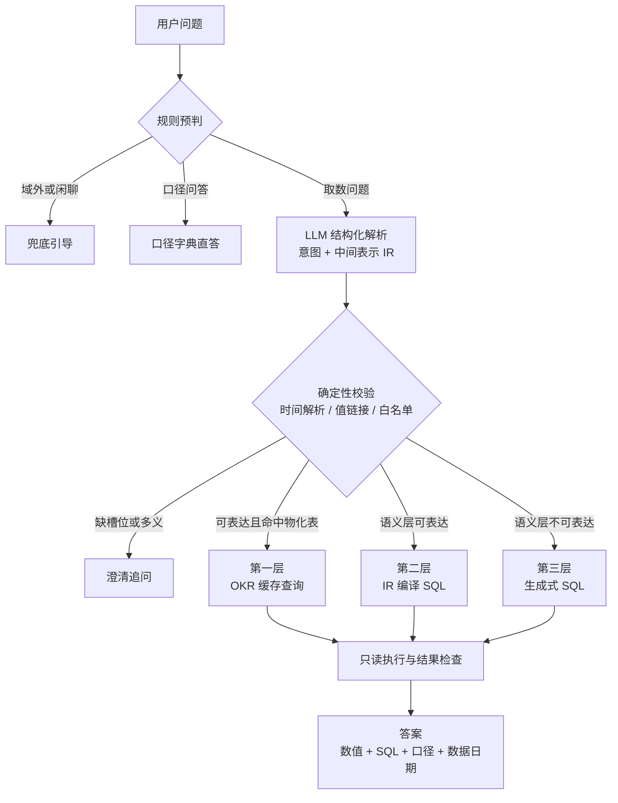
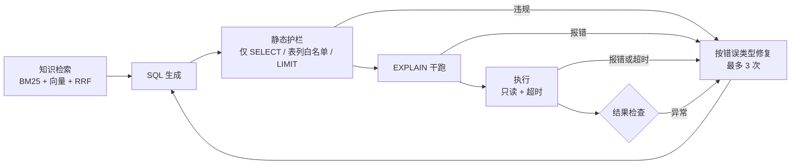

# 项目规划：分层 Text2SQL 取数 Agent

面向银行风控取数场景，语义层优先、生成式兜底的 Text2SQL 系统。

## 1. 目标与边界

| 编号 | 目标 | 验收标准 |
|---|---|---|
| G1 | 分层取数链路跑通 | 路由、第一层（OKR 缓存）、第二层（语义层编译）、第三层（生成式 SQL）、澄清、兜底均可端到端运行 |
| G2 | 效果可量化 | 自建分层评估集与 BIRD 外部基准上，给出路由、槽位、执行准确率与成本数据 |
| G3 | 设计可论证 | 每个关键设计对应一项实验或测试证据 |

不纳入范围：模型微调与强化学习、多候选生成与投票、长对话管理、真实权限系统（以只读连接与护栏模拟）、生产部署。

## 2. 数据与场景

### 2.1 数据源

PKDD'99 捷克银行真实脱敏数据，即 BIRD 基准中的 financial 库。8 张表：account（4,500）、client（5,369）、disp、card（892）、loan（682）、order、trans（1,056,320）、district（77），时间范围 1993-01-01 至 1998-12-31。字段含捷克语编码（如 PRIJEM、VYBER）与无语义列名（district.A2 至 A16），需要字段字典与值映射。

参考日期配置为 1998-12-31，所有相对时间（今年、上月、近三个月）基于该日期解析，答案标注数据截止日期。

### 2.2 数仓分层

| 层 | 表 | 内容 | 生成方式 |
|---|---|---|---|
| ODS | 原始 8 张表 | 账户、客户、交易、贷款等 | 只读，不修改 |
| DWD | dwd_risk_event | 风险事件明细：大额现金取现、快进快出、透支罚息 3 条规则命中记录 | SQL 规则脚本，阈值由数据探查确定 |
| ADS | ads_okr_monthly | 月度风控 OKR 指标（月份 × 地区 × 风险类型） | 由语义层指标定义物化生成 |

ADS 表由语义层指标定义物化，第一层与第二层的口径一致由构造保证，并以单元测试逐月核对。

## 3. 系统架构

### 3.1 主流程



### 3.2 第三层子流程



### 3.3 中间表示（IR）

LLM 只输出业务层参数，物理映射由注册表确定性完成。

| 字段 | 含义 | 规范化方式 |
|---|---|---|
| metrics | 指标编码（限定在注册表枚举内） | 白名单校验 |
| query_type | point / breakdown / trend / compare | 枚举 |
| time_text | 时间表达原文 | 规则解析器转为日期区间 |
| grain | 日 / 月 / 季 / 年 | 枚举 |
| dimensions | 分组维度编码 | 白名单校验 |
| filters | 维度 + 筛选值原文 | 值链接为枚举编码 |
| compare | 同比 / 环比 / 自定义基期 | 规则计算基期区间 |
| order、limit | 排序与 TopN | 数值校验 |

## 4. 关键设计决策

| 编号 | 决策点 | 方案 | 理由 |
|---|---|---|---|
| D1 | 路由依据 | 语义层覆盖度：能否被已治理指标与维度完整表达 | 统一划分标准；频率只决定哪些指标优先纳入治理 |
| D2 | 路由实现 | 规则预判（零调用）加一次 LLM 结构化解析（意图与 IR 合并输出） | 规则处理确定性强的请求，LLM 处理语义理解，一次调用控制延迟 |
| D3 | 时间解析 | 规则解析器，基于参考日期 | 可单测，杜绝日期幻觉 |
| D4 | 值链接 | 枚举别名词典加模糊匹配；一词多义触发澄清 | 值与口径多义是企业场景主要误差来源 |
| D5 | 第一层 | 物化表确定性查询；按指标可加性判断能否跨粒度汇总 | 不让 LLM 读数；去重计数等非可加指标不能由月值累加 |
| D6 | 第三层知识 | 声明性知识（表、列、枚举、口径、示例 SQL）混合检索；过程性知识（SQL 方言、安全规则）写入系统提示 | 按知识类型组织，而非统一向量化 |
| D7 | 纠错 | 按错误类型处理：字段与语法错误回注修复；护栏违规重生成；超时补过滤条件；最多 3 次 | 不可恢复错误不应重试 |
| D8 | 安全 | 只读连接、仅允许单条 SELECT、表列白名单、自动 LIMIT、执行超时 | 模拟生产环境护栏 |
| D9 | 编排 | 纯 Python 显式工作流，每次请求输出完整轨迹 | 固定流程加有界循环，无需 Agent 框架，便于调试与讲解 |
| D10 | 模型接口 | 统一接口；DeepSeek（OpenAI SDK）与 Claude（Anthropic SDK）分文件实现 | 可切换，支撑模型对比实验 |

## 5. 评估设计

### 5.1 评估集

| 评估集 | 规模 | 用途 |
|---|---|---|
| 自建风控评估集（中文） | 约 100 题，dev 与 test 按 4:6 切分 | 端到端、路由、槽位、执行准确率 |
| BIRD financial（2025-11 清洗版） | 该库全部题目 | 第三层外部基准 |

自建评估集题型：第一层 15、第二层 35、第三层 30、澄清 10、域外与口径问答 10。

构建原则：评估集先于系统开发编写并冻结；金标 SQL 人工编写并执行校验；few-shot 示例库与评估集不重叠；test 集只用于最终报告。

### 5.2 指标

| 维度 | 指标 |
|---|---|
| 路由 | 准确率、各类召回率、混淆矩阵 |
| 解析 | 槽位准确率（指标、维度、筛选、时间、查询类型） |
| 执行 | 执行准确率 EX、可执行率、纠错挽回率 |
| 交互 | 澄清触发的精确率与召回率 |
| 效率 | 延迟 P50 / P95、LLM 调用次数、token 与成本 |

EX 判定：BIRD 采用官方结果集比较；自建集允许额外说明列（列子集匹配），排序类问题比较行序，数值统一精度。

### 5.3 实验

| 编号 | 实验 | 回答的问题 |
|---|---|---|
| X1 | 端到端评估（DeepSeek） | 系统整体效果与各层流量分布 |
| X2 | 架构对比：分层链路 vs 全部走生成式 SQL | 为什么不全部让 LLM 写 SQL |
| X3 | 第三层消融：知识注入、few-shot、纠错循环 | 各组件的边际贡献 |
| X4 | Schema 全量 vs 检索（BM25、向量、混合） | 该规模下 schema linking 是否必要 |
| X5 | 模型对比：DeepSeek vs Claude | 确定性链路与生成链路对模型能力的敏感度 |

## 6. 技术栈

| 类别 | 选型 |
|---|---|
| 语言与环境 | Python 3.12 或 3.13（以依赖兼容性为准），uv 管理依赖 |
| 数据库 | SQLite，只读模式 |
| 模型 | DeepSeek `deepseek-flash`（默认）；Claude `claude-opus-5`（对比实验） |
| 结构化输出 | DeepSeek JSON 模式；Claude 结构化输出；Pydantic 校验 |
| SQL 处理 | Jinja2 参数化模版（第二层）；sqlglot 解析与护栏（第三层） |
| 检索 | 自实现 BM25（中文字符二元组切分）；fastembed + bge-small-zh-v1.5；RRF 融合；numpy 向量检索 |
| 交互 | rich 命令行；Streamlit 演示界面 |
| 测试 | pytest |

## 7. 目录结构

```text
Text2SQL/
├── src/text2sql/
│   ├── llm/            # 模型接口：base、deepseek、claude
│   ├── db/             # 只读执行器、EXPLAIN 干跑、SQL 护栏
│   ├── semantic/       # 注册表加载、IR、时间解析、值链接、编译器、SQL 模版
│   ├── knowledge/      # 知识目录、BM25、向量检索、few-shot 示例库
│   ├── pipeline/       # 路由、第一/二/三层、澄清、兜底、答案组装、工作流
│   └── eval/           # 评估集加载、EX 比较、指标统计、报告
├── semantic/           # 指标、维度、表字典 YAML（语义层单一事实源）
├── scripts/            # 数据下载、数仓分层构建、数据探查
├── eval/               # 自建评估集 dev / test
├── tests/              # 单元测试
├── app/                # Streamlit
├── docs/               # 规划、实验报告
├── README.md           # 中文主文档，含英文摘要
└── README_EN.md        # 英文完整文档
```

## 8. 里程碑

| 里程碑 | 周期 | 内容 | 确认点 |
|---|---|---|---|
| M1 | 第 1 天 | 环境、数据下载、数仓分层、数据探查、语义层 YAML | 数据与指标口径 |
| M2 | 第 2 天 | 自建评估集 dev / test、金标 SQL、EX 比较器、评估框架 | 评估集 |
| M3 | 第 3 至 4 天 | 语义层编译（第一、二层）、路由、澄清、兜底、口径问答、工作流 | 确定性链路 |
| M4 | 第 5 天 | 第三层：知识检索、生成、护栏、干跑、纠错 | 生成链路 |
| M5 | 第 6 天 | X1 至 X5 实验与误差分析 | 实验结果 |
| M6 | 第 7 天 | 命令行、Streamlit、README 中英文 | 可发布版本 |

每个里程碑完成后提交本地 commit 并确认；推送 GitHub 前单独确认。

## 9. 风险与应对

| 风险 | 应对 |
|---|---|
| BIRD 标注噪声（Mini-Dev 标注错误率 52.8%） | 使用 2025-11 清洗版；失败样本人工归因，区分系统错误与标注问题 |
| 自建评估集存在作者偏差 | 先冻结后开发；dev / test 切分；包含同义改写；以 BIRD 做外部校验 |
| LLM 结构化输出不稳定 | JSON 模式加 Pydantic 校验，失败重试一次，再失败降级 |
| Claude Opus 5 不支持 temperature | 以 effort 控制推理深度，报告中注明运行差异 |
| 数据许可 | 数据库文件不入仓，脚本下载；按 CC BY-SA 4.0 署名 |
| 成本 | DeepSeek 开发与实验预计数美元；Claude 对比实验预计 30 至 100 美元，运行前按实测单题成本复核 |

## 10. 交付物

| 类别 | 内容 | 位置 |
|---|---|---|
| 公开 | 代码、语义层 YAML、评估集、实验报告、规划文档、README 中英文 | GitHub 仓库 |
| 私密 | 实习评估、文档 1（项目说明）、文档 2（STAR 面试准备） | 本地 interview_prep/（已被 .gitignore 排除） |

## 11. 下载清单

| 文件 | 来源 | 大小 | 用途 |
|---|---|---|---|
| dev.zip | bird-bench.oss-cn-beijing.aliyuncs.com（BIRD 官方） | 346 MB | 提取 financial.sqlite 与字段说明，其余删除 |
| dev_20251106 JSON | huggingface.co/datasets/birdsql/bird_sql_dev_20251106 | 约 1 MB | BIRD 清洗版题目 |
| bge-small-zh-v1.5 ONNX | Hugging Face（经 fastembed 获取） | 约 90 MB | 中文向量模型 |
| Python 依赖 | PyPI | 约 200 MB | openai、anthropic、pydantic、sqlglot、fastembed、streamlit 等 |
